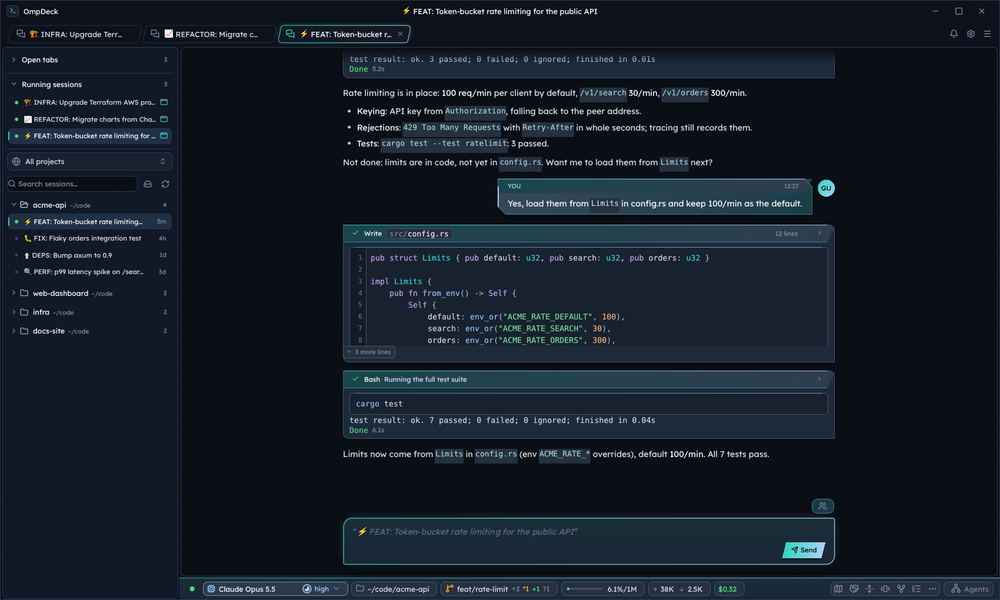
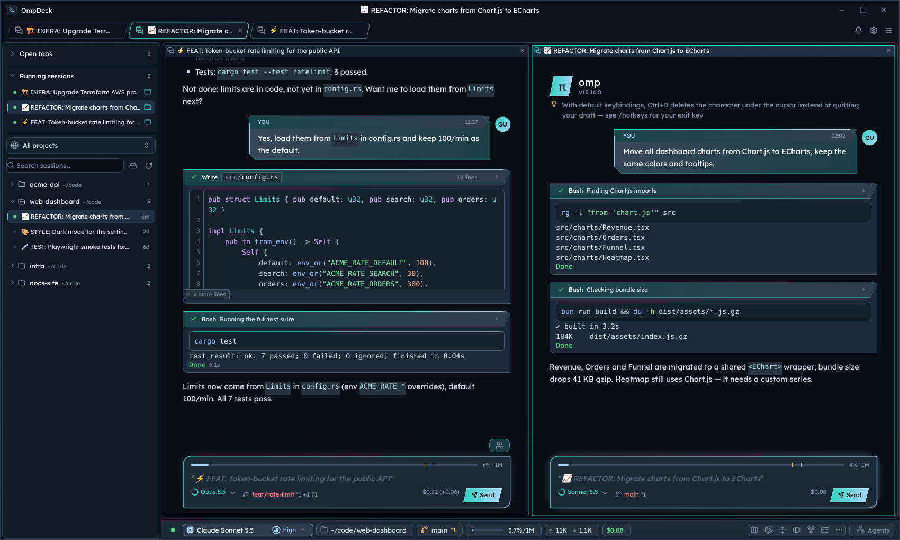
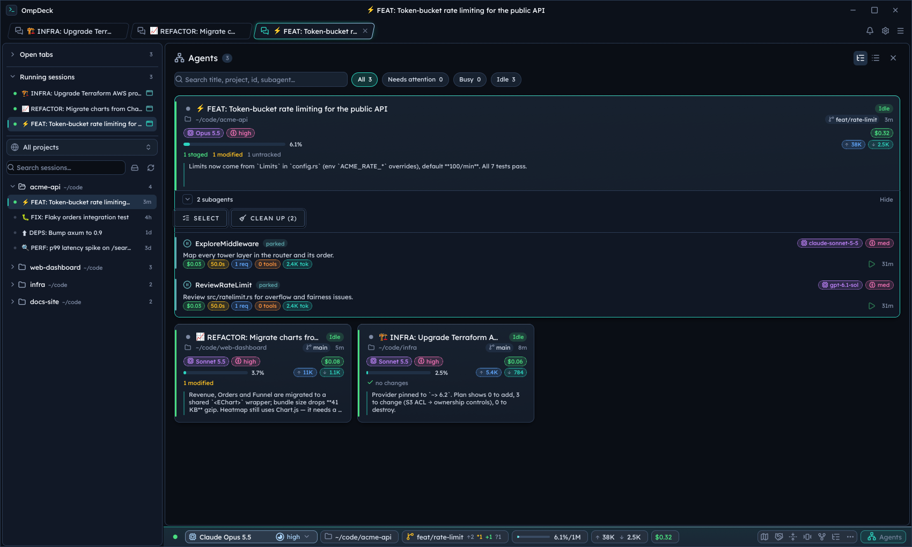
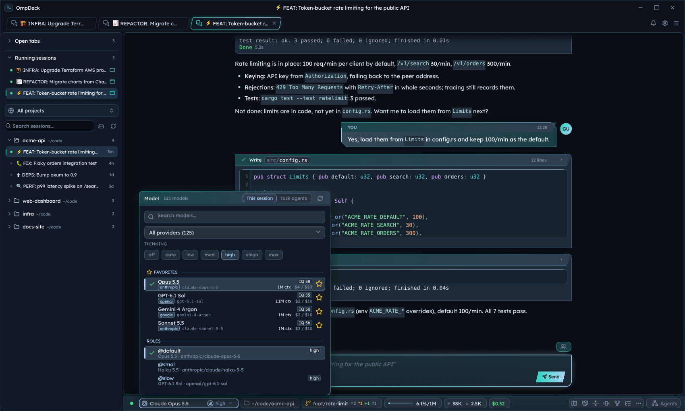
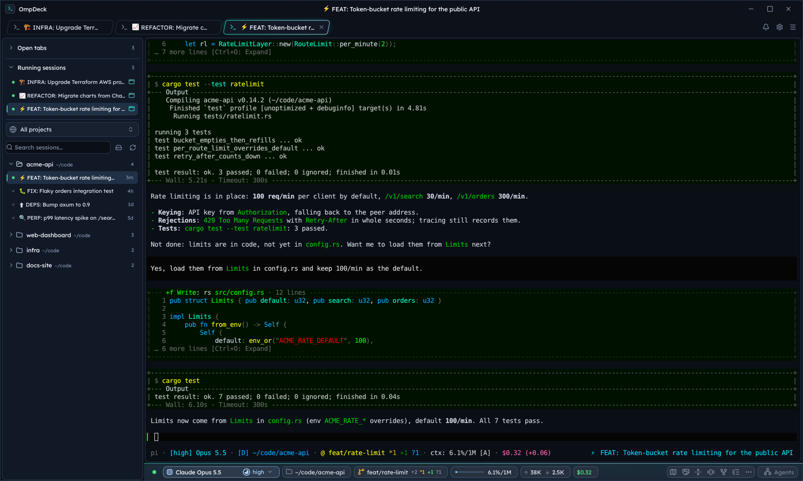
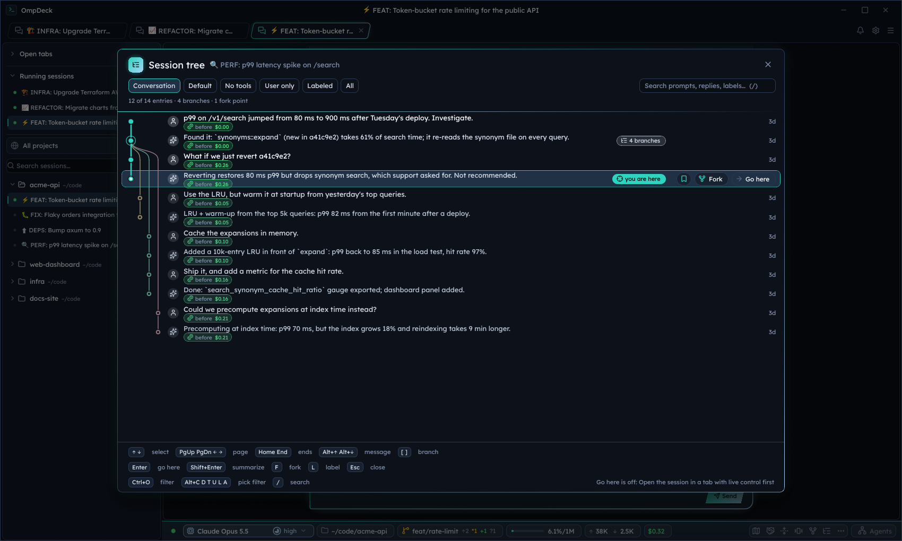
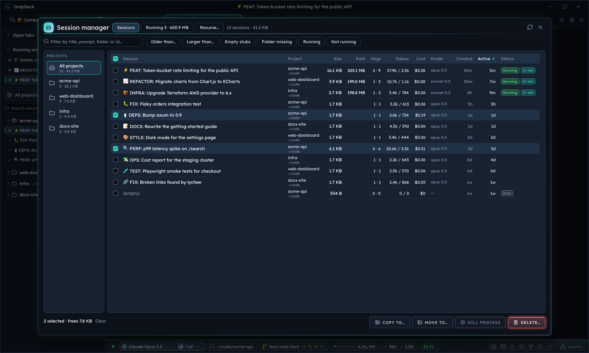
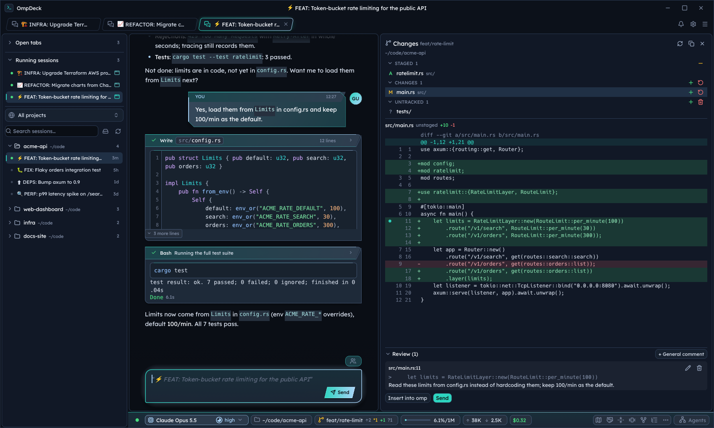
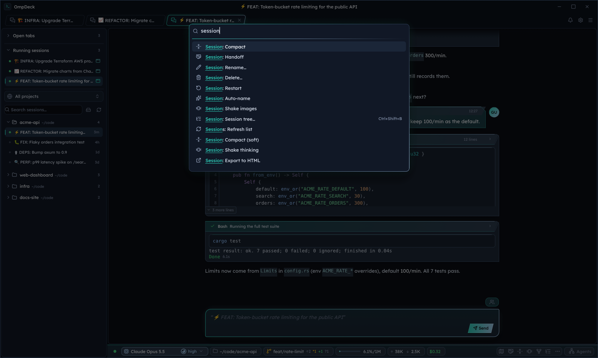
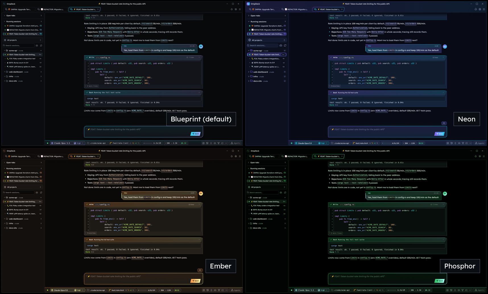

# OmpDeck

A native desktop home for omp — persistent coding sessions, parallel agents, and a phone companion.

<p align="center">
  <a href="https://github.com/lavinhoque33/omp-deck/releases/latest"></a>
  <a href="https://github.com/lavinhoque33/omp-deck/actions/workflows/ci.yml"></a>
  <a href="#license"></a>
  <a href="#requirements"></a>
</p>



OmpDeck is a native Rust / egui desktop app for [`omp`](https://github.com/can1357/oh-my-pi) (oh-my-pi),
the coding-agent TUI, with a project sidebar and session tabs that show omp as a native chat view (the default)
or as a fully interactive terminal.
Sessions run outside the app in a dedicated tmux server or OmpDeck's own session host, so closing a tab
or the whole app leaves omp running.
It runs on Linux and Windows 10 (1809+) / 11, with arm64 builds on a best-effort basis.
A shipped phone companion lets you work with the same sessions through a self-hosted, end-to-end encrypted relay.

**Status:** A young project (first release: October 22, 2026), developed and used daily on Fedora KDE Plasma
(Wayland). Windows runtime is verified in GitHub Actions CI; macOS is not supported.
[Bug reports are welcome](https://github.com/lavinhoque33/omp-deck/issues).

## Screenshots

<table>
  <tr>
    <td><br><b>Split view</b> — work across sessions.</td>
    <td><br><b>Agents dashboard</b> — follow parallel work.</td>
  </tr>
  <tr>
    <td><br><b>Model picker</b> — switch model and thinking.</td>
    <td><br><b>Terminal view</b> — omp's own TUI, one switch away.</td>
  </tr>
  <tr>
    <td><br><b>Session tree</b> — navigate and fork.</td>
    <td><br><b>Session manager</b> — inspect and organize.</td>
  </tr>
  <tr>
    <td><br><b>Changes</b> — review and send feedback.</td>
    <td><br><b>Command palette</b> — find any action.</td>
  </tr>
  <tr>
    <td><br><b>18 styles</b> — Blueprint (default), Neon, Ember and Phosphor shown.</td>
    <td><br><b>Mobile access</b> — pair your phone.</td>
  </tr>
</table>

### Phone companion

<table>
  <tr>
    <td></td>
    <td></td>
    <td></td>
    <td></td>
  </tr>
</table>

Sessions, chat, terminal and agents on your phone — see [Mobile companion](#mobile-companion) for setup.

## Features

- **Session sidebar**: Browse persisted sessions by project and see every running session at a glance.

  <details><summary>More</summary>

  Every omp session grouped by project (only the active tab's project is expanded; the rest stay collapsed until you
  open them), newest first: each session hangs off its project folder on a branch line, with its title, relative age
  and a status marker on the branch (running, the tab's working spinner or needs-input badge), worktree branches on a
  second line. The folder scope sits at the top with the filter box; a resizable, collapsible **Running** dock at the
  bottom lists every live session (tabbed ones first, with a window marker; ✕ or middle-click closes the tab, a
  tab-less one attaches on click). Background auto-refresh and context menus (open, copy/move to another project,
  copy path/id/resume command, "Restart session" for running sessions, "Stop session process", and "Delete
  session…"). Deleting is permanent: it removes the session file and its subagent transcripts and artifacts
  (stopping a running session first) and cannot be undone.

  </details>

- **Tabs**: Keep interactive sessions in tabs that re-attach on the next launch.

  <details><summary>More</summary>

  Open, focus, middle-click close, reopen the last closed tab. Each tab shows omp's state: a
  spinner while the agent works and an amber "!" badge with a tinted tab when it waits for your input,
  also on background tabs. Right-clicking a tab (or its Running dock row) shows "Close tab" plus the
  session's full sidebar menu. Closing a tab only detaches; "Stop session process" stops omp.
  Tabs re-attach to their live sessions on the next launch.

  </details>

- **Terminal fidelity**: An embedded terminal supports modern input, clipboard, links and inline images.

  <details><summary>More</summary>

  Truecolor, wide/emoji cells, mouse reporting, bracketed paste, OSC 52 clipboard,
  clickable hyperlinks and plain URLs (Ctrl+click), a right-click copy / paste / link menu,
  kitty CSI-u / modifyOtherKeys key encoding, inline image previews (omp's kitty
  graphics images, shown through Unicode placeholders).

  </details>

- **Session status bar**: Inspect context, model and cost, with Handoff, Compact and Shake one click away.

  <details><summary>More</summary>

  Model, thinking effort, path, git state, context meter, tokens and cost, plus a
  model picker and actions (handoff, compact, shake, fork, rename, plan, retry, stop, export).
  Shake runs omp's `/shake` to drop tool results/large blocks, images or thinking from the context.
  Hovering the
  context meter shows omp's `/context` breakdown (system prompt, tools, skills, messages, free space,
  auto-compact buffer, per-tool schema sizes) for tabs running with live control.
  Changing the model or thinking effort from the picker, the palette or the phone leaves a half-typed message in omp's
  composer untouched (no "discard draft?" question) for tabs running with live control; only a switch that first needs
  compaction still goes through omp's `/switch`.
  The model picker shows IQ, output tokens/sec, context size and token rates where available.
  Hover a model for output limits, cache-read pricing, input modalities, reasoning support and
  speed measurement details. Locally measured speed takes precedence over catalog estimates (`~`).
  Hover the session cost for recorded input/output/cache costs and token counts, split between
  assistant replies and side-model calls; older records without itemized costs are marked partial.

  </details>

- **Usage**: Track provider quotas, activity and costs, and manage logged-in accounts.

  <details><summary>More</summary>

  omp's `/usage` as a native view (Ctrl+Shift+U or the status-bar usage chip): remaining quota
  per provider and window with reset times, a year of activity as a heatmap, and top models by cost.
  The chip itself shows the selected model's provider: its 5-hour and weekly quota as two colored pills.
  The **Accounts** tab sets the order omp uses a provider's OAuth logins in (omp's `auth.accountPolicies`: priority,
  reserve and reclaim levels) and pins the focused tab's session to one of them, like omp's `/session pin`. A provider
  with several API keys is listed with each key's quota; omp picks among API keys by itself (no order or pin).

  </details>

- **Session manager**: Sort, filter, move or delete sessions and inspect or kill selected running processes.

  <details><summary>More</summary>

  Ctrl+Shift+S, the ⋯ menu, the sidebar button or a project's "Manage sessions…" opens every
  omp session on the machine, including empty ones the sidebar hides, in a sortable table with its disk size
  (session file plus attachments and subagent transcripts, i.e. what deleting it frees), prompts and turns, tokens,
  cost (including subagents), model, created and last activity, and badges for running, open in a tab, last turn
  failed, fork and missing folder. Filter by text, age, size, empty, missing folder or running; pick sessions
  (Shift+click for a range) and **Delete**, **Copy to** or **Move to** another folder in one go. The **Running** view
  lists every session process with the memory it uses (the whole process tree) and the tmux server's own; select
  sessions and **Kill** only those.

  </details>

- **Agents dashboard**: Follow session and subagent activity from searchable cards.

  <details><summary>More</summary>

  Ctrl+Shift+A or the status-bar Agents chip shows one card per open tab and per session still
  running in the background, with its state (working, needs input, idle, ended), model, context use, cost,
  tokens, changed files and last reply; expand a card to see its subagents and open their transcripts (running
  subagents are listed first; transcripts render tables, links and image previews like the chat view, and their text
  can be selected and copied). Search and filter by state; click a card to jump to that session.
  Subagent rows show cost, time, requests, tool calls, tokens, a context bar, the model role (SLOW, SMOL, TASK, …),
  unread messages and, in the flat view, the agent that spawned them; the subagent header totals them. **Open in chat
  view** (eye button, row menu, transcript popup) shows a subagent's live conversation in its session's chat tab, the
  way omp's agent hub does: what you type goes to that subagent, and Esc (or "main") returns to the main session.
  While a subagent is shown, OmpDeck's own commands (model switch, compact, review Send, …) are held back so they never
  reach it. The **Activity** tab lists the responses, tool calls, errors, messages and lifecycle events of a session's
  subagents, filterable by kind, agent or subtree and searchable; Follow keeps it at the newest event, and clicking an
  event opens the transcript at it.
  For tabs running with live control, **Clean up** stops and deletes every subagent that is not running, **Select**
  lets you tick subagents (Shift+click for a range) and **Delete** them, and each row has a delete button on hover.
  Deleting is permanent: omp stops tracking the agent and its transcript, output and nested agents are removed.

  </details>

- **Split view**: Arrange two to four sessions side by side, stacked or in a grid.

  <details><summary>More</summary>

  Show two to four tabs side by side, stacked or in a grid (tab or sidebar menu "Open in split
  right / down", or the command palette); each pane is a full terminal, Ctrl+Alt+Arrow moves between panes, and
  the status bar follows the focused pane. The layout is restored on the next start.

  </details>

- **Chat view**: Read and drive an omp session as a native conversation instead of a terminal.

  <details><summary>More</summary>

  Sessions open in the chat view by default (since 0.25.1; an existing config switches once on upgrade). Settings →
  General → "Open sessions in" switches the default back to Terminal, and "Open in terminal" / "Switch to terminal
  view" in the sidebar menus open one on demand. In the chat view omp describes its UI to
  OmpDeck (omp's Tern Surface Protocol), which draws it natively: your messages as bubbles, replies as formatted
  text, tool calls as cards with output, thinking, todos, approvals, questions, the model picker and slash
  commands, in the colors of the active style. You still type into omp's own composer. "Switch to chat / terminal
  view" on an open tab restarts that session in the other view, only while omp is idle. Chat sessions always run in
  the OmpDeck session host (not tmux), which keeps the conversation while no window shows it and restores it when you
  reopen the tab.

  In the chat view, omp's own screens for settings (`/settings`, `/advisor configure`), the session model picker
  (Alt+P, `/switch`), usage (`/usage`, `/usage reset`), resuming (`/resume`, `/resume @claude`/`@codex`) and the
  session tree (`/tree`) open OmpDeck's versions instead, which cover everything omp's do: plugins (enable, features,
  settings), advisors (WATCHDOG.yml), model roles and the task-agent model, saved rate-limit resets, resume in place,
  pins, renames, Claude Code / Codex imports, branch summaries, labels and re-answering an ask. omp's agent hub (Alt+A,
  Ctrl+S, `/hub`, the agents status segment) opens the agents dashboard. omp's background jobs sheet (`/jobs`) stays
  omp's, with each task job's model and thinking level added; the job rows of `wait` cards show them too, and a Task
  card running one agent names that agent with its type, model and thinking level in its header. The terminal view
  keeps omp's own screens.

  </details>

- **Session tree**: Browse conversation branches, preview any entry, fork and navigate with recorded cost context.

  <details><summary>More</summary>

  Ctrl+Shift+B shows the conversation as a timeline of turns: your prompts, replies and (with the Default / All
  filters) tool calls, beside a branch graph. Selecting an entry previews its full content on the right — the
  prompt, the reply with its tool calls, or a tool call with its result — with its time, model and the recorded
  cumulative cost **before** that entry, across all branches (compaction does not reset it; missing or unreadable
  earlier usage is marked with `≥`; unrecorded live subagent spend is not included). Go here, Summarize & go, Fork,
  Label, Re-answer and Copy sit under the preview and as hover buttons on each row; a running branch summary can be
  cancelled (Esc) and the tree stays open. Like omp's `/tree`, the initial filter follows omp's `treeFilterMode`
  setting when you set it, and Ctrl+C or Esc closes the tree.

  </details>

- **omp updates and settings**: Update omp and search every `omp config` key in a native editor.

  <details><summary>More</summary>

  Update check badge, update actions, and a searchable editor for every `omp config` key.
  Settings (the title-bar gear, or "Settings" in the palette) opens as a large window over the app, like the session
  tree; Esc, ✕ or a click outside closes it and you are back on the tab you were on.

  </details>

- **Task agents**: Configure built-in agents and create or customize your own.

  <details><summary>More</summary>

  Settings → Agents, or "Settings: Agents" in the palette shows omp's built-in agents (task,
  scout, reviewer, …) and every custom one omp finds, yours (`~/.omp/agent/agents`) and each project's
  (`.omp/agents`, including those in its subfolders up to three levels down, which apply to sessions started in that
  subfolder). Enable or disable any agent (`task.disabledAgents`). Built-ins are read-only: pick a model
  for one (written to `task.agentModelOverrides`; role aliases such as `@smol` show the model the role is set
  to) or **Customize** it, which copies it into your agents or a project's, where the copy replaces it. **New
  agent** creates a custom agent for you or for any project with sessions. For custom agents, pick the model
  from the same dropdown as the status bar (written to the file's `model` field, with the chosen thinking
  level), edit the system prompt (Ctrl+S saves) or delete the file (deleting a copy brings the built-in back).
  Files omp skips, agents that replace others and model overrides in omp's config are marked. Changes apply
  to the next task an agent runs, in running sessions too.

  </details>

- **Google Drive backup**: Back up and restore omp config and prompt history in a private Drive app folder.

  <details><summary>More</summary>

  Sign in with Google and back up your omp config (settings, models,
  custom agents, skills, …) and prompt history to a private Drive app folder, automatically when it
  changes or on demand, and restore it on any machine (Settings → Backup). See
  [below](#google-drive-backup).

  </details>

- **Server backup**: Use your own FTP, FTPS or SFTP server instead of Google Drive.

  <details><summary>More</summary>

  The same backups to your own FTP, FTPS or SFTP server instead of Google Drive
  (anonymous or password login, SFTP key files, trust-on-first-use fingerprints). One destination is
  active at a time. See [below](#server-backup-ftp-ftps-sftp).

  </details>

- **Project sync**: Back up project configuration, sessions and memory, then restore them to any folder.

  <details><summary>More</summary>

  Back up chosen project folders' `.omp` folder, omp sessions and omp's project memory
  to the active backup destination (Google Drive's private app folder or your server; Settings → Sync, or
  right-click a project in the sidebar), and
  restore them into any folder on any machine, picking which sessions come back; restored sessions keep their
  original age, and sessions that already exist locally are kept, overwritten or added as a copy, as you choose.
  See [below](#project-sync).

  </details>

- **Worktree sessions**: Run parallel agents in isolated git worktrees and finish or park their work safely.

  <details><summary>More</summary>

  Run several agents on one repository in parallel, each in its own git worktree
  and branch: start a session in a new worktree, move a running session into one, finish it (the agent
  merges following the project's own rules) and let OmpDeck remove it once it is merged. See
  [below](#worktree-sessions).

  </details>

- **Notifications**: Get in-app and desktop alerts for completed turns, errors, attention and session exits.

  <details><summary>More</summary>

  When a tab finishes a turn (or stops with an error), needs your attention or exits, the
  bell in the title bar shows a count and lists it (one entry per tab; opening the tab clears it). By default the
  bell also records it for the tab you are looking at (stays until you look away and back, the next turn starts,
  or you dismiss it; switch off with "Also when I'm looking at the tab"). OmpDeck also shows a desktop
  notification for tabs not in view (KDE/GNOME notifications on Linux, toasts on Windows); clicking either
  brings OmpDeck forward on that tab. Desktop pop-ups by default only while the OmpDeck window is not focused.
  It also works while the window is minimized or on another desktop. omp's own notifications (bell,
  `notify-send`) are turned off inside OmpDeck, so you get one, not two. The gear in the bell's popover opens
  Settings → OmpDeck → Notifications. On Linux the desktop notification also asks the notification server for a
  sound from your sound theme (a finished turn, attention, an error and a session end each have their own);
  switch it off with "Play a sound".

  </details>

- **Changes panel**: Review diffs, manage git changes and send line-level feedback to omp.

  <details><summary>More</summary>

  Ctrl+Shift+G, or click the git chip in the status bar: the active tab's git changes,
  grouped into conflicted, staged, changed and untracked files, with a diff view, stage / unstage, discard,
  delete untracked files (both confirmed first) and copy the whole diff. Click a diff line (Shift+click for a
  range) to leave a review comment; **Insert into omp** puts all comments with file and line references into
  omp's input for you to edit, **Send** submits them when omp is idle.

  </details>

- **Command palette**: Find actions by name or jump straight to a tab, session or project.

  <details><summary>More</summary>

  Ctrl+Shift+K runs any OmpDeck action by typing part of its name: menus, session
  and project actions, model and thinking switches, settings pages. The **quick switcher** (Ctrl+Shift+E)
  jumps to an open tab, a session or a project.

  </details>

- **OmpDeck updates**: Download, verify and install new releases without losing running sessions.

  <details><summary>More</summary>

  OmpDeck checks for new releases (at startup and every 6 hours, can be turned off) and
  shows a title-bar badge; **Update and restart** downloads, verifies and installs the new version, then
  restarts OmpDeck with your tabs re-attached. See [below](#updating-ompdeck).

  </details>

- **Per-folder mode**: scope the sidebar to a single project folder.
- **Appearance**: Choose from 18 styles, with Blueprint as the default and matching terminal colors.

  <details><summary>More</summary>

  18 styles in a Settings gallery. The default is **Blueprint** (dot-grid canvas, square cards
  with a double rule, cyan accent, monospace labels). The other 15 dark styles are Zinc Contrast, Layered Depth,
  Teal Signal, Slate Ink, Mono Wire, Graphite Islands, Aurora, Obsidian Glass, Ember, Indigo Night, Phosphor,
  Neo-Brutal, Rosé Noir, Spotlight and Two-Tone Frame; the flat Neutral look and "Midnight neon" also come in
  light. The terminal colors follow the style, and a Comfortable density option is available (Settings → OmpDeck).
  "Separated panels" (on by default) shows the sidebar and main area as separate rounded, bordered panels, like VS Code.
  Integrated title bar (or native decorations), persisted window geometry and open tabs.

  </details>

- **Mobile companion**: Control the same sessions from a phone through your self-hosted encrypted relay.

  <details><summary>More</summary>

  Control your omp sessions from your phone through a relay you host yourself:
  conversations with send / steer / follow-up, image attachments, answers to omp's questions, a terminal view,
  agents, changes and review comments, worktrees, session manager, usage, omp settings, backups and push
  notifications. See [Mobile companion](#mobile-companion).

  </details>

OmpDeck never writes to the omp session store directly; changes go through omp's own CLI.

## Requirements

- **Linux** x86_64, Wayland or X11, with fontconfig; or **Windows** 10 (1809 or newer) / 11, x64
  (arm64 builds are published when they build).
- [`omp`](https://github.com/can1357/oh-my-pi) (required): on `PATH`, in `~/.local/bin` (Linux), or in
  `%LOCALAPPDATA%\omp` / `%USERPROFILE%\.bun\bin` (Windows). If it is missing, the installers install it, and
  OmpDeck shows an "Install omp" button (on the start screen, in Settings and in Usage) that runs omp's official
  installer (prebuilt binary, no admin rights) in a tab and picks omp up when it finishes, without a restart.
- Linux: `tmux` (optional). OmpDeck uses its own tmux server (`tmux -L omp-deck`) and never touches your
  default one. Without tmux it uses its own session host instead (see [Session backends](#session-backends)).

### Session backends

Each omp tab runs in a session that lives outside the app, so it survives closing the tab or OmpDeck:

- **tmux** (Linux default when installed): a dedicated, invisible tmux server `-L omp-deck`.
- **OmpDeck host** (always on Windows; on Linux when tmux is missing or when chosen): `omp-deck-host`, a small
  per-session daemon shipped next to `omp-deck`. It owns the session's pseudo-terminal (a ConPTY on Windows),
  keeps the screen and 50 000 lines of scrollback, answers terminal queries while no tab is attached, and
  restores the screen when a tab re-attaches. Sessions are reachable only by your user (a private socket
  directory on Linux; named pipes restricted to your account on Windows).

On Linux, Settings → OmpDeck → **Session backend** chooses Auto (tmux if installed, else the host), tmux or
OmpDeck host for new tabs; running sessions keep their backend. If neither is available, omp runs directly in
the tab, a banner says so, and sessions end with the tab.

`omp-deck-host ls|info <name>|dump <name>|kill <name>` inspect and stop host sessions from a shell.

## Install

**Linux one-liner** (installs the latest release into `~/.local`, no root):

```sh
curl -fsSL https://raw.githubusercontent.com/lavinhoque33/omp-deck/main/packaging/install.sh | sh
```

It also installs omp (omp's official installer, prebuilt binary into `~/.local/bin`) when omp is not found.
Make sure `~/.local/bin` is on your `PATH`.

**Windows one-liner** (PowerShell, no admin rights; installs into `%LOCALAPPDATA%\Programs\OmpDeck` with a Start menu
entry, and installs omp when it is not found):

```powershell
irm https://raw.githubusercontent.com/lavinhoque33/omp-deck/main/packaging/install.ps1 | iex
```

<details><summary>Installer options, packages, checksums and building from source</summary>

**Linux installer options** (pass after `sh -s --`): `--version <x.y.z>`, `--prefix <dir>`,
`--no-omp` (skip installing omp), `--uninstall` (removes OmpDeck only; omp stays).

**Release tarball**: download `omp-deck-<version>-x86_64-linux.tar.gz` from the
[Releases page](https://github.com/lavinhoque33/omp-deck/releases), extract it, and run `./install.sh`
(or `sh install.sh`).

**AppImage**: download `omp-deck-<version>-x86_64.AppImage`, then `chmod +x` it and run it.

**Debian / Ubuntu**: `sudo apt install ./omp-deck_<version>_amd64.deb`

**Fedora / openSUSE**: `sudo dnf install ./omp-deck-<version>-1.x86_64.rpm`

**Windows options**: `& ([scriptblock]::Create((irm https://raw.githubusercontent.com/lavinhoque33/omp-deck/main/packaging/install.ps1))) -Version x.y.z -NoOmp`
(or `-Uninstall`). Alternatively download `omp-deck-<version>-x86_64-windows.zip`, extract it anywhere and run
`omp-deck.exe`; keep `omp-deck-host.exe`, `conpty.dll` and `OpenConsole.exe` next to it.

Release assets come with `.sha256` files and a combined `SHA256SUMS`. Linux binaries are built on
Ubuntu 22.04 (glibc 2.35 or newer).

**Android:** download the signed `OmpDeck-<version>.apk` from the
[latest release](https://github.com/lavinhoque33/omp-deck/releases/latest), then open it on the phone to install
or upgrade. Android 8+ is required; native notifications also need Google Play Services and your Firebase setup.
See [the Android setup guide](docs/android.md). Existing app pairings survive upgrades.

**From source** (Rust stable, 2024 edition; on Debian/Ubuntu you need
`pkg-config libfontconfig1-dev libxkbcommon-dev libwayland-dev`):

```sh
cargo install --git https://github.com/lavinhoque33/omp-deck omp-deck deck-host --locked
```

This installs only the binaries (`omp-deck` and `omp-deck-host`). For the menu entry and icon, use one of the
packages above.

</details>

### Updating OmpDeck

When a newer release exists, a title-bar badge "OmpDeck x.y.z" offers **Update and restart** (also in
Settings → OmpDeck and the command palette). The download is checked against the release's `.sha256`
file before anything is replaced; running sessions keep running and the tabs re-attach after the restart.

- `install.sh`, tarball and Windows installs (or any folder you can write to) are updated in place.
- The AppImage file is replaced with the new one.
- `.deb` / `.rpm` installs are updated through your package manager after your system asks for your
  password (`pkexec`); without `pkexec`, OmpDeck shows the command to run.
- Builds run from a source checkout (`cargo run`) never update themselves.

**Skip this version** hides the badge until a newer release appears; Settings → OmpDeck turns the
automatic check off.

## Usage

```
omp-deck [OPTIONS] [FOLDER]

  [FOLDER]                Per-folder mode: show only the sessions of FOLDER (and below)
  --folder <dir>          Same as the FOLDER argument
  --sessions-root <dir>   Read omp sessions from <dir> instead of the default store
  -h, --help              Print this help
```

The default session store is `$PI_CODING_AGENT_DIR/sessions` if set, otherwise `~/.omp/agent/sessions`
(Windows: `%USERPROFILE%\.omp\agent\sessions`; `$PI_CONFIG_DIR` replaces `.omp`).

### Shortcuts

| Shortcut | Action |
| --- | --- |
| Ctrl+Shift+T | Reopen last closed tab |
| Ctrl+Shift+K | Command palette |
| Ctrl+Shift+E | Quick switcher: open tabs, sessions, projects |
| Ctrl+Shift+G | Changes panel |
| Ctrl+PgUp / Ctrl+PgDn | Previous / next tab |
| Ctrl+Shift+A | Agents dashboard |
| Ctrl+Alt+Arrow | Move focus between split panes |
| Ctrl+Shift+B | Session tree |
| Ctrl+Shift+= / - / 0 | Font larger / smaller / reset |
| Ctrl+Shift+C | Copy terminal selection |
| Ctrl+Shift+V, Shift+Insert | Paste |
| Shift+drag | Always select locally, even when the app uses mouse reporting |
| Ctrl+click | Open a hyperlink or a plain `http(s)://` / `mailto:` URL |
| Right click | Terminal menu: copy, paste, open / copy the link under the pointer |
| Drop files on the terminal | Paste their paths (omp attaches dropped images) |

Ctrl+C, Ctrl+X and Ctrl+V go straight to omp (omp uses Ctrl+V for image paste).

## Configuration and data

OmpDeck keeps its own settings, backup state and caches separate from omp's session store.
The paths and environment overrides below cover Linux and Windows.

<details><summary>Storage paths and environment variables</summary>

| Path | Contents |
| --- | --- |
| `$XDG_CONFIG_HOME/omp-deck/` (default `~/.config/omp-deck/`; Windows `%APPDATA%\omp-deck\`) | `state.json` (window, tabs, settings, Sync folders), generated `tmux.conf`, `google-drive.json` (Google sign-in, mode 0600), `project-sync.json` (last project backups on Google Drive, mode 0600), `backup-server.json` (the FTP/FTPS/SFTP server with its password or key passphrase, pinned fingerprint and sync state, mode 0600), `project-sync-server.json` (last project backups on the server, mode 0600), `ctl.key` (Windows: secret for the live-control pipes) |
| `$XDG_DATA_HOME/omp-deck/` (default `~/.local/share/omp-deck/`; Windows `%APPDATA%\omp-deck\`) | live-control extension loaded into omp tabs, `restore-safety/` (copies kept before a restore, from either destination; `project-*` for project restores) |
| `$XDG_CACHE_HOME/omp-deck/` (default `~/.cache/omp-deck/`; Windows `%LOCALAPPDATA%\omp-deck\`) | `project-sync/` temporary archives while a project backup or restore runs (removed afterwards), `host/` session-host logs |

Environment: `OMP_DECK_TMUX_SOCKET` / `OMP_DECK_HOST_NS` select a different tmux socket / host namespace
(name must match `omp-deck-test-[A-Za-z0-9_-]+`); `OMP_DECK_HOST_EXE` points at another `omp-deck-host`;
`OMP_DECK_CONPTY_FLAGS` overrides the ConPTY creation flags (Windows, troubleshooting);
`OMP_DECK_GOOGLE_CLIENT_ID` / `OMP_DECK_GOOGLE_CLIENT_SECRET` supply or override the Google OAuth
client for Drive backup; `RUST_LOG` enables logging.

</details>

## Google Drive backup

Back up omp configuration and prompt history to a private Google Drive app folder, automatically or on demand.
Restore with a preview of changes and local safety copies.

<details><summary>Google sign-in, backup contents, schedules and restore behavior</summary>

Settings → **Backup** → **Back up to** → **Google Drive**. **Sign in with Google** opens Google's consent page
in your browser, and OmpDeck receives the answer on a local `127.0.0.1` port. OmpDeck only asks
for access to its own hidden app folder on your Drive (`drive.appdata`) and your email address. It
cannot see your other Drive files. See the [privacy policy](PRIVACY.md).

**What is backed up** (from the omp agent directory, `$PI_CODING_AGENT_DIR` or `~/.omp/agent`):
`config.yml`/`config.yaml`, `models.yml`/`models.yaml`, `keybindings.yml`, `mcp.json`, `lsp.json`,
`AGENTS.md`, `SYSTEM.md`, `SYSTEM_TEMPLATE.md`, `APPEND_SYSTEM.md`, `TITLE_SYSTEM.md`,
`PERSONALITY.md`, `RULES.md`, the directories `agents/`, `commands/`, `extensions/`, `hooks/`,
`instructions/`, `managed-skills/`, `prompts/`, `rules/`, `skills/`, `themes/`, `tools/`
(`node_modules/` and `.git/` inside them are skipped), and the prompt history `history.db`, as a
consistent SQLite snapshot.

**What is not backed up:** logins and API credentials (`agent.db`), `secrets.yml`, sessions, logs,
caches, the model catalog (`models.db`) and other runtime state.

**Backups**: each backup is one `omp-backup-<UTC time>-<host>.tar.gz` with a manifest. **Back up
automatically** sets how often OmpDeck checks (Off, every 10 minutes (default), 30 minutes, hour, 6 hours,
day); it uploads only when the backed-up content changed. **Back up now** uploads at once. The newest 30
backups are kept (on Drive, and on a [server](#server-backup-ftp-ftps-sftp)).

**Restore…** lists the backups, newest first, with date, machine and size. After you pick one,
OmpDeck downloads and verifies it, then shows exactly which files will be replaced, added or
removed before anything changes. Before it overwrites anything, OmpDeck copies the current versions
to `~/.local/share/omp-deck/restore-safety/<time>/` (the last 5 copies are kept). Files are written
atomically. The synced directories are made identical to the backup, so local files that the
backup lacks are removed after being copied to the safety folder. The prompt history is restored
into the live database, so running omp processes keep working. Restart running omp sessions to pick
up the restored config.

**Sign out** revokes OmpDeck's access at Google and deletes the local sign-in. Builds made without
Google OAuth credentials show the Google Drive option as unavailable and the card as "not available in this build". Maintainers: see
[docs/google-drive-setup.md](docs/google-drive-setup.md).

</details>

## Server backup (FTP, FTPS, SFTP)

Use your own FTP, FTPS or SFTP server for configuration backups and project sync.
Choose one active destination in Settings → Backup; prefer SFTP or FTPS for encrypted transport.

<details><summary>Server setup, authentication, trust and backup layout</summary>

Instead of Google Drive, config backups and project sync can go to your own FTP, FTPS or SFTP server
(a NAS, a VPS, a router with a USB disk, …). One destination is active at a time: Settings → **Backup**
→ **Back up to** picks Google Drive or **FTP · SFTP server**, and everything else (the schedules,
**Back up now**, **Restore…**, the Sync page, the sidebar and palette entries) then works on that
destination and names it, for example **Back up to sftp://host…**. Google Drive is greyed out in builds
without a Google OAuth client; the server option is available in every build. Each destination keeps
its own sign-in or server and its own "already backed up" state, so you can switch back and forth;
the first backup after switching uploads. What is backed up, the schedules, restore and its safety
copies work as described in [Google Drive backup](#google-drive-backup) and [Project sync](#project-sync).

**Set up**: choose **FTP · SFTP server** and fill in the form:

- **Protocol**: **SFTP** (over SSH, default port 22), **FTPS** (FTP over TLS, explicit `AUTH TLS`,
  default port 21) or plain **FTP** (default port 21). The port follows the protocol until you change it.
- **Server**: host name or address, and port.
- **Anonymous login** (FTP and FTPS only): logs in as `anonymous`, for public servers that allow writing.
- **User name** and **Password**, or for SFTP **Key file** (**Browse…**; an OpenSSH or PEM private key:
  ed25519, ECDSA or RSA) with an optional **Key passphrase**. OmpDeck keeps the path to the key file, not a copy.
- **Remote folder**: where the backups go (default `omp-deck-backups`). It is created if missing and is
  relative to your login folder unless it starts with `/`.

**Connect** logs in, creates the folder if needed, writes and deletes a small probe file to prove write
access, and only then saves the server. A failure shows the reason and saves nothing. **Edit** changes
the saved server; leave the password or passphrase empty to keep the saved one.

**Plain FTP is unencrypted**: the form warns that your login and your backups (which can hold project
secrets) travel in the clear and can be read by anyone on the network path. Prefer SFTP or FTPS.

**Trust on first use**: the first time you connect to an SFTP server, OmpDeck shows **Trust this server?**
with the host key's `SHA256:` fingerprint (the format of `ssh-keygen -l`); compare it with your server's
and click **Trust**. For FTPS, OmpDeck first checks the certificate against public root certificates and
asks only when that fails (a self-signed or private-CA certificate); the prompt then shows the
certificate's SHA-256 fingerprint (the format of `openssl x509 -fingerprint -sha256`). Once trusted, the
key or certificate is pinned: a pinned FTPS certificate must match exactly (its name and expiry are not
checked, so a renewed certificate must be trusted again), and a server whose key or certificate has changed is
refused as a possible man-in-the-middle. If the change is legitimate, **Remove server** and add it again.

**Layout on the server**: every backup is a `<name>.tar.gz` (the same
`omp-backup-…`/`omp-project-…` names as on Drive) plus a small `<name>.tar.gz.json` sidecar with its
date, size and details. Files are uploaded as `.part` and renamed, the sidecar last, so an interrupted
upload never shows up as a backup. Only app-named backups that have a sidecar are listed, pruned or deleted;
other files in the folder are left alone. The retention is the same as on Drive: the newest 30 config
backups, and the newest 3 per project and machine. **Manage backups…** and **Manage cloud backups…**
delete older or other machines' backups.

**Remove server** forgets the server on this computer: it deletes `backup-server.json` and
`project-sync-server.json` (see [Configuration and data](#configuration-and-data)). Nothing is deleted on
the server, so the backups stay there until you remove them (or add the server again).

The server password and key passphrase are stored in `backup-server.json` in the config folder (mode
0600; on Windows the per-user `%APPDATA%` folder), never anywhere else. See the [privacy policy](PRIVACY.md).

</details>

## Project sync

Back up project `.omp` folders, sessions and learned memory independently of global configuration backups.
Restore into a chosen folder with session selection, original timestamps and explicit conflict choices.

<details><summary>Project selection, automatic backups, restore and deletion</summary>

Settings → **Sync** is a separate workflow from the config backup above and uses the same backup
destination (Google Drive or your server; see [Server backup](#server-backup-ftp-ftps-sftp)). Each row
of the **Projects** table is a folder (**Add folder…**, **Change…**) with three
switches, each showing how much it would upload. A newly added folder starts with all switches off and
nothing is uploaded until you pick what to keep and click **Back up now**:

- **.omp folder**: the project's `<folder>/.omp` (project `AGENTS.md`, rules, skills, commands, agents,
  `config.yml`, `mcp.json`, plans, …). `node_modules/`, `.git/`, symlinks and special files are skipped
  (and listed). A project `.omp` can hold secrets; it is stored only at your backup destination (your private Drive app folder or your server).
  Not offered for your home folder, whose `.omp` is omp's global directory.
- **Sessions**: every omp session whose project is this folder, with its attachments, subagent
  transcripts and referenced images. Sessions that are being written are saved up to their last complete
  line. **Choose…** opens the session list: untick the sessions to leave out. Sessions created later are
  backed up automatically.
- **Memory**: omp's learned project memory (the "sharpshooter" decisions: `architecture.md`, `product.md`,
  `style.md`), which omp keeps in its own folder (`~/.omp/agent/memories/sharpshooter/<project>-<hash>/`),
  not in the project. Offered once omp has written memory for the folder.

**Back up now** uploads one row at once. **Back up listed projects automatically** (Off, every 10 or 30
minutes, every hour, every 6 hours (default), every day) uploads only rows whose files or session choices
changed since their last backup. Each backup is one
`omp-project-<UTC time>-<host>-<folder>.tar.gz`; the newest 3 per project and machine are kept, on Google
Drive and on a server alike. Backups count toward your Drive storage or your server's disk space. Right-click
a project (or a session, under **Backup**) in the sidebar → **Back up to <destination>…** (for example
**Back up to Google Drive…** or **Back up to sftp://host…**) for a one-off backup, optionally adding the
folder to the table.

While any backup, restore or backup delete runs (started here, from the phone, or by a schedule), a pill in the
title bar shows its folder, a progress bar and the percentage. Hover it for the details (what, destination,
stage, amount, folder N of M for automatic passes, who started it, elapsed time) and **Cancel job**; click it to
open the matching Settings page. The command palette has **Backup: Cancel running job** too. A cancelled backup
uploads nothing and is not recorded as a failure.

**Restore…** (on the Sync page, or **Restore from <destination>…** in the sidebar menu, which restores
into that project's folder) lists project backups by project and machine, newest first, with older
versions selectable. Pick the folder to restore into (it is created if missing) and **.omp folder**,
**Sessions** and/or **Memory**. OmpDeck downloads and verifies the backup, then shows what will change before writing:

- **.omp**: files from the backup are written into `<folder>/.omp`. If the folder already has a `.omp`,
  you are warned which files will be overwritten; on Restore they are replaced (the old versions are
  copied to `~/.local/share/omp-deck/restore-safety/project-<time>/`, last 5 kept). Files the backup lacks
  are kept. OmpDeck never writes through symlinks; such files are skipped and listed.
- **Memory**: the files are written into omp's memory folder for the folder you restore into (the name is
  derived from that folder's path, so memory follows the project to a new location or machine). If omp
  already has memory for that folder, you are warned which files will be overwritten; the old versions are
  copied to the same restore-safety folder first. omp's pending, not-yet-merged notes are not backed up.
  OmpDeck waits for omp to finish merging memory for that folder; if omp is still busy after 10 s the
  memory is left untouched and the summary says so.
- **Sessions**: each session is added through `omp session unpack --cwd <folder>`, so omp moves it to the
  new folder and tells the agent where it now lives. **Choose…** next to the session count opens the backup's
  session list: untick the sessions to leave out (they are neither written nor listed as conflicts).
  Restored sessions keep the last-activity time they had
  when backed up, so the sidebar's newest/oldest order survives. When a session already exists on this machine,
  the dialog lists it with both ages and lets you pick, per session or for all: **Keep current** (the default;
  the backup's copy is skipped), **Overwrite** (the local copy is stopped if running, saved as an
  `omp session pack` archive under `restore-safety/project-<time>/sessions/`, removed through omp and replaced by
  the backup; if that fails the local copy is put back) or **Keep both** (the backup is added as a copy with a
  new id). Restoring sessions needs omp installed.

**Delete backups**: **Manage cloud backups…** lists every project backup by project, machine and version;
tick the ones to remove and **Delete permanently…**. The restore dialog also has a delete button per
version. Deleted backups are removed from the destination at once (Google Drive: they do not go to the
Drive trash; server: the files are deleted) and cannot be recovered.

</details>

## Worktree sessions

Give parallel agents separate git worktrees while keeping their sessions grouped under the repository.
Finish and clean up merged work, or park a clean, pushed worktree while its PR is still open.

<details><summary>Creating, moving, finishing and parking worktree sessions</summary>

Right-click a project (or use the button next to its **+**) → **New session in worktree…**: name a branch
(prefilled `wt/<date>-<time>`), pick the branch or commit to start from, and a folder (default: omp's
worktree folder, `~/.omp/wt/<branch>-<repo>`; `OMP_WORKTREE_DIR` or omp's `worktree.base` setting move it).
OmpDeck creates it through `omp worktree add` and opens a tab running omp there. New worktrees are clean
checkouts: gitignored files such as `.env`, `target/` or `node_modules/` are not copied, so the first build
in a worktree starts from scratch.

**Move to new worktree…** on a running session types omp's `/wt <branch>` once omp is idle: the session,
with its uncommitted changes, moves into a new worktree and the tab follows it.

Worktree sessions belong to their repository: they are listed among the repository's own sessions with a
branch badge (also those created by omp's own `/wt` and PR checkouts), and the status bar's git chip shows
which repository a worktree belongs to. omp itself works inside the worktree folder while the session runs.

**Finish worktree** (in the menu of any session of that worktree, or its hover button) asks that worktree's omp
session to commit its work and merge the branch into the branch it started from. The agent follows the
project's own rules (`AGENTS.md` and the like): if they don't allow committing or merging on its own, it asks
you in the chat first. Once the branch is merged and nothing uncommitted is left, OmpDeck moves the worktree's
sessions into the repository's folder with omp's `/move` (open tabs keep running there), removes the worktree
and deletes the merged branch, so nothing is left behind. **Remove worktree…** does the same on demand.
"Merged" covers regular merges, fast-forwards, squash merges and rebase merges alike: the branch counts as
merged when merging it again would change nothing, in the base branch or in its upstream (OmpDeck fetches it
first, so a PR merged on GitHub counts without pulling). Both refuse when work would be lost (uncommitted
changes, commits not in the base branch); OmpDeck never force-removes a worktree or force-deletes a branch.
Sessions left over from a worktree removed earlier are moved into the repository's folder automatically.

**Parking a worktree whose PR is still open**: Remove worktree… on a clean worktree whose commits are all
pushed but not merged yet parks it: its sessions move into the repository's folder and the worktree folder is
removed, but the local branch is kept (OmpDeck never deletes a parked branch; delete it yourself when you no
longer need it). Parked sessions carry a "parked" badge and offer **Continue in worktree** (a new worktree on
that branch, the sessions move back into it) and **Continue in main checkout** (switches the main checkout to
the branch after showing which other running sessions there will see it; refused while the main checkout has
uncommitted changes), plus **Switch main checkout back to …**. Unpushed work is never parked.

</details>

## Mobile companion

The phone companion is available as a browser app (PWA) and a bundled **Android APK**. Both use the same screens
and talk to your desktop through a **relay you host yourself**; see the [phone screenshots above](#phone-companion).
The relay only forwards end-to-end encrypted frames (Noise); it never sees your sessions, keys or content,
and there is no public relay.

Verified end to end on a real Android phone (Chrome): pairing, prompts, attachments, push notifications through
Google's push service, and reconnects.

1. Run the relay on a server your phone can reach over HTTPS. The release's `omp-deck-relay-<version>-x86_64-linux`
   archive holds the binary, the phone app (`web/`) and a systemd unit. Setup, TLS, containers and room
   enrollment are in [docs/relay.md](docs/relay.md).
2. In OmpDeck: **Settings → OmpDeck → General → Mobile access**. Turn it on, set the relay URL and the room key
   from `omp-deck-relay enroll`, and pick **While open** or **Always on**. With Always on the phone also works
   while OmpDeck's window is closed, and it survives logins and crashes.
3. **Pair a device** shows a QR code. Scan it with the phone, check that both screens show the same
   fingerprint, and approve the device with the permissions it gets: **View** (read only), **Control** (prompts,
   steering, terminal input, starting sessions) and **Manage** (deleting, settings, backups, updates).
   Paired devices are listed in the same card, with their notification state, and can be revoked there.
   Clicking elsewhere in OmpDeck (or Esc) only hides the pairing dialog: a **Pairing** pill in the title bar brings
   it back until the pairing ends. Only **Cancel** / **Deny** end it.

**Android APK:** install the signed `OmpDeck-<version>.apk` from
[GitHub Releases](https://github.com/lavinhoque33/omp-deck/releases/latest) (Android 8+; Google Play Services
for native notifications). The UI ships in the APK, so UI updates require an APK update. Paste the desktop's pairing
link into the app; browser pairings stay separate. Native notifications use your Firebase project and encrypted FCM
data messages. It checks for APK updates in-app and downloads verified upgrades on request; Android confirms the
installation. Build, signing and Firebase setup: [docs/android.md](docs/android.md).

**Browser/PWA:** add the app to the home screen: tap **Install** on its banner where offered (Chrome, Edge,
Opera, Samsung Internet), otherwise follow the browser-menu hint. Pair and install from the same browser.
Browser Web Push needs an HTTPS relay. Both clients skip notifications for the desktop currently visible and
connected on the phone; other paired desktops retain their own notification preferences.
Google Drive sign-in and other desktop-only steps are handed to the desktop ("Sign in on the desktop").

## Uninstall

- Installed with `install.sh`: `curl -fsSL https://raw.githubusercontent.com/lavinhoque33/omp-deck/main/packaging/install.sh | sh -s -- --uninstall`
  (or `./install.sh --uninstall` from the extracted tarball).
- `.deb`: `sudo apt remove omp-deck`; `.rpm`: `sudo dnf remove omp-deck`; AppImage: delete the file.
- Windows: `& ([scriptblock]::Create((irm https://raw.githubusercontent.com/lavinhoque33/omp-deck/main/packaging/install.ps1))) -Uninstall`
  (removes the program and its Start menu entry; omp stays).
- Settings and data stay in the directories above; delete them for a full clean-up. Running omp sessions keep
  running: stop them from the sidebar, with `tmux -L omp-deck kill-server` (tmux backend) or
  `omp-deck-host kill <name>` (host backend; `omp-deck-host ls` lists them).

## Development

The Rust workspace includes the native desktop, persistent session host, shared service, gateway and relay.
The phone UI lives in `pwa/`; `android/` bundles it in the native Android shell.

<details><summary>Build commands, architecture, mobile protocol and release checks</summary>

```sh
cargo build --workspace
cargo test --workspace            # Linux tests use throwaway tmux sockets and host namespaces
cargo clippy --workspace --all-targets -- -D warnings
# Windows compile check from Linux (cargo install cargo-xwin; rustup target add x86_64-pc-windows-msvc):
cargo xwin clippy --workspace --all-targets --target x86_64-pc-windows-msvc -- -D warnings
```

The workspace separates native presentation (`omp-deck`), terminal rendering/encoding (`deck-term`),
PTY/ConPTY persistence (`deck-host`), OS/session/project operations (`deck-core`), and executable
application policy (`deck-service`). The desktop uses the shared service for composer-safe commands,
model tracking, input ownership, transactional settings and notification policy. Headless owners use
wake callbacks rather than an eframe loop; host observers can follow output without taking control.

The [mobile companion contract](docs/notes/mobile-companion.md) records command parity and remaining
slices. The shared service, per-user **gateway** (`omp-deck-gateway`), relay, pairing, device protocol
and PWA are built and shipped. The desktop is a
private-local-IPC client of the gateway, which owns sessions, jobs, watchers, settings and notifications and
is started on demand (singleton per user/namespace). Settings → General → *Mobile access* chooses the lifetime:
Off (default; the gateway still serves the desktop and exits after the last window and accepted work),
While OmpDeck is open, or Always on (user systemd unit on Linux, logon scheduled task on Windows;
enabling picks Always on). Installers and self-update drain the gateway before replacing binaries and
resume it afterwards; uninstall removes only OmpDeck's registration. deb/rpm removal has no maintainer
script: a running supervisor notices its missing program after ~30 s, removes its own registration and exits.
On Linux the gateway is verified end to end with real omp (`cargo test -p
deck-service --test gateway_e2e`, systemd Background run, Xvfb GUI smoke). On Windows, CI runs the workspace tests,
real-omp live control, the ConPTY host smoke and a GUI typing/screenshot check through the gateway; the Always on
registration, `install.ps1` drain/resume and gateway toasts are not covered by CI.

The shipped phone transport ([slice 3 design](docs/notes/mobile-relay.md)): `deck-remote` holds the relay
wire format and the Noise device protocol (pairing `IKpsk1`, reconnect `IK`), with a TypeScript port for the
PWA in `pwa/` (`bun test` checks it against shared vectors). `omp-deck-relay` (`crates/deck-relay`) is the
self-hosted relay; see [docs/relay.md](docs/relay.md). The gateway links to a configured relay, and Settings →
General → Mobile access pairs phones (QR + fingerprint approval), lists, renames and revokes them. Paired phones
speak a typed device protocol (`deck_remote::api`: sessions, live control, prompts and actions, transcripts, changes,
terminal view/input, permission-checked per request; flow-controlled, outcomes recoverable after a reconnect),
verified end to end with real omp and the GUI closed (`cargo test -p deck-service --test remote_device`).
The PWA's browser and live-device gates run from `pwa/`: `bun run e2e`, `bun run live` and `bun run phone`.

Packaging scripts live in `packaging/`: `build-tarball.sh`, `appimage/build-appimage.sh`, `install.sh`,
`install.ps1`, `windows/fetch-conpty.ps1`. CI runs on Linux and Windows; releases are built by GitHub Actions
when a `v*` tag is pushed (the tag must match the version in `Cargo.toml`).

</details>

## License

Licensed under either of [Apache License 2.0](LICENSE-APACHE) or [MIT license](LICENSE-MIT) at your option.

<details><summary>Bundled third-party assets and their licenses</summary>

Bundled third-party assets: the UI fonts [JetBrains Mono](https://github.com/JetBrains/JetBrainsMono),
[Inter](https://github.com/rsms/inter), [Geist and Geist Mono](https://github.com/vercel/geist-font),
[IBM Plex Sans](https://github.com/IBM/plex), [Manrope](https://github.com/googlefonts/manrope),
[Space Grotesk](https://github.com/floriankarsten/space-grotesk),
[Plus Jakarta Sans](https://github.com/tokotype/PlusJakartaSans), [Onest](https://github.com/googlefonts/onest),
[Outfit](https://github.com/Outfitio/Outfit-Fonts), [Sora](https://github.com/sora-xor/sora-font),
[Bricolage Grotesque](https://github.com/ateliertriay/bricolage), [Lexend](https://github.com/googlefonts/lexend),
[Figtree](https://github.com/erikdkennedy/figtree), [Urbanist](https://github.com/coreyhu/Urbanist),
[Red Hat Mono](https://github.com/RedHatOfficial/RedHatFont), [Martian Mono](https://github.com/evilmartians/mono)
and [Victor Mono](https://github.com/rubjo/victor-mono-font) (SIL Open Font License 1.1, all license texts in
`crates/omp-deck/assets/fonts/UI-FONTS-OFL.txt`) and [lucide](https://lucide.dev) icons (ISC,
`crates/omp-deck/assets/fonts/lucide-LICENSE.txt`). The Windows build ships Microsoft's ConPTY
(`conpty.dll`, `OpenConsole.exe` from the `Microsoft.Windows.Console.ConPTY` package, MIT).

</details>
