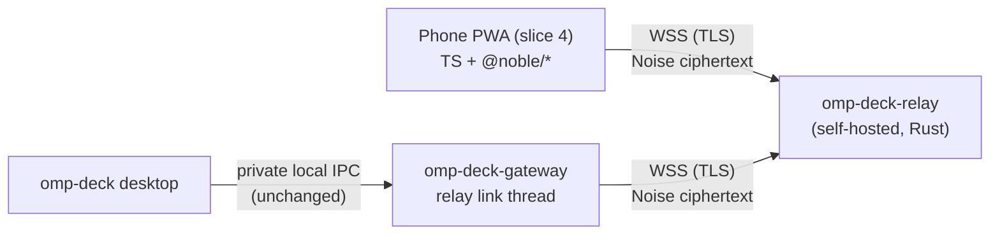

# Mobile companion slice 3: relay, pairing and remote protocol

Status: **accepted design, in implementation** (2026-10-27). The user decided: the relay is **self-hosted only** for now
and written in **Rust**, and accepted every proposed choice ("Decisions" below). The exact wire protocol is frozen only
after the security review gate (step R5). Library facts were verified against crates.io/npm/GitHub on 2026-10-27
(sources at the end).

## Components

- **`omp-deck-relay`**: new bin crate `crates/deck-relay` (axum + tokio). Routes opaque frames between one gateway and
  its paired devices. Holds no session content and no keys that decrypt it. Ships as a plain binary, a systemd unit and
  a container image; TLS is terminated by a documented reverse proxy (Caddy recommended) or in-process rustls.
- **Gateway relay link**: one dedicated thread in `omp-deck-gateway`, outbound only, enabled only when Mobile access is
  on and a relay URL is configured. A remote device becomes a new connection role (`Role::Device`) of the existing
  engine: same journal, epochs, outcome lookup and notification inbox; no second session owner.
- **PWA**: slice 4. Slice 3 delivers a test client (Rust CLI and the TS Noise module with cross-tests) so the transport is
  provable before any UI exists.

## Trust and threat model

| Party | Trusted for | Not trusted for |
|---|---|---|
| Desktop user + gateway | everything (it is the machine being controlled) | — |
| Paired phone | the permissions granted to that device at approval | other devices' traffic; anything after revocation |
| Relay operator / relay host | routing and availability | confidentiality or integrity of content, device identity, authorization |
| Network path | nothing | — |
| PWA delivery origin | serving the client code (it can read the phone's keys) | — (E2E does not protect against a malicious origin) |

| Threat | Mitigation |
|---|---|
| Relay reads or alters commands/output | Noise transport: AEAD with per-direction nonce counters; relay sees only ciphertext + routing header |
| Relay or attacker replays an old handshake/command | IK message 1 carries a per-device monotonic timestamp (WireGuard-style), rejected if ≤ last seen; commands never in message 1; transport counters reject replays; mutations keep `RequestKey` dedup + journal, never auto-resent |
| Stolen/expired QR code | PSK is one-use, expires after 2 min, only valid while the desktop pairing window is open; the desktop must approve the device (fingerprint + name) before any key is stored |
| QR secret leaks into logs/server | QR carries the secret in the URL **fragment** (never sent to a server); never logged; pairing id ≠ secret |
| Compromised/lost phone | Per-device keys; revoke on the desktop → key removed, live sessions closed, relay token invalidated, push subscription deleted; replaying old traffic cannot restore it |
| A paired phone escalates to arbitrary code execution | **Remote capability model** (below): devices get typed, narrowed operations, never the local IPC's arbitrary `LaunchSpec.argv` |
| Anyone floods the relay | Relay admission tokens, per-IP and per-room connection caps, per-connection byte/message rate limits, bounded queues that drop slow peers, frame size cap |
| Slow phone exhausts gateway memory | Remote outbox byte-bounded (events and replies), oversized replies paged; same lagging → `Resync` policy as local links |
| Relay metadata (who/when/how much) | Accepted and documented: the relay sees connection times, sizes and the room/peer ids |
| Malicious PWA origin | Out of scope for crypto; self-hosters serve the PWA themselves; no secrets cached by default |

## Handshake (recommended design)

`snow` 0.10 on the gateway (`default-features = false`; X25519, ChaChaPoly, BLAKE2s) and a small TypeScript Noise state
machine on `@noble/curves` / `@noble/ciphers` / `@noble/hashes` (audited) in the PWA, cross-tested against snow and the
Noise test vectors.

1. **Gateway identity**: a static X25519 key generated once, stored in the gateway's private app dir (Unix 0600; Windows
   user-only DACL). Its BLAKE2s fingerprint is shown in Settings.
2. **Pairing window** (desktop only: Settings → Mobile access → "Pair a device"): the gateway creates a one-use pairing
   token (relay admission) and a 32-byte PSK, valid 2 minutes. QR = `https://<pwa-origin>/#pair=<PairingInvite>` (relay
   URL, room, pairing token, gateway static public key, PSK; see the R1 contract).
3. **Pairing handshake**: `Noise_IKpsk1_25519_ChaChaPoly_BLAKE2s`. The PSK is mixed at the end of message 1, so a wrong
   PSK fails message 1's payload decryption and is rejected before the desktop prompt (with WireGuard's `IKpsk2` the PSK
   enters only in message 2, so a device holding just the gateway key and pairing token would reach approval). Message 1
   payload: device name, platform, timestamp. The gateway consumes the PSK, then **holds** the handshake and shows "Allow
   <name>, fingerprint <…>?" on the desktop. Approve → device static key + granted permissions stored, message 2 sent;
   deny/timeout → closed.
4. **Reconnect**: `Noise_IK_25519_ChaChaPoly_BLAKE2s`. The gateway checks the device's static key against the registry
   from message 1 (unknown/revoked → closed before message 2) and the timestamp against the last seen.
5. **Session**: the handshake hash is the session id. Rekey every 2^20 messages or 30 min. Application frames over 64 KiB
   are split (Noise's message cap is 65 535 bytes) and reassembled under the existing `wire` caps.

Runner-up (if a hand-written TS Noise is rejected): `noise-handshake` 4.2.0 in the PWA with XXpsk0 pairing (then compare
the responder key with the QR key) and IK reconnect over BLAKE2b; neither it nor its `sodium-universal` backend has an
audit, and its pattern set is limited. Rejected: a custom X25519+Ed25519 protocol (violates "vetted protocol"), PAKEs
(the QR already carries a 256-bit secret; Rust/JS implementations are unaudited or stale), `magic-wormhole` (EUPL-1.2).

## Relay protocol

Code contract: `deck_remote::relay` (`crates/deck-remote/src/relay.rs`, orchestrator-owned): `Hello`, `ToRelay`,
`FromRelay`, `RoomKey`, `close` codes, size limits.

- Endpoints over WSS: `/v1/gateway`, `/v1/device` (WebSocket upgrade), `/healthz` (200 `ok`). Binary messages only.
- **Rooms are enrolled by the self-hoster**: `omp-deck-relay enroll` creates a 16-byte room id and a 32-byte room secret,
  stores `sha256(secret)` and prints a `RoomKey` (`ompdeck-relay-v1:<base64url(room ‖ secret)>`) that the user pastes into
  OmpDeck with the relay URL. The relay is therefore never an open service.
- First client message = `Hello` (`'G'|'D'`, version 1, room, secret/token), within 10 s; the relay answers `HELLO_OK`
  or closes with a `close` code. Afterwards a device sends and receives raw payloads (one Noise message each, ≤ 65 535
  bytes); the gateway sends `ToRelay::{Data, Tokens, Close}` and receives `FromRelay::{Data, Open, Closed}` tagged with
  the relay-assigned `PeerId`.
- **Admission tokens** live only in relay memory: the gateway sends its full set (`ToRelay::Tokens`, SHA-256 hashes) right
  after every hello, so a relay restart needs no database. Removing a hash closes that device (`UNAUTHORIZED`). Each
  paired device gets its own random 256-bit relay token inside the encrypted pairing reply; an open pairing window
  registers the invite's one-use pairing token. Until a newly admitted gateway's first `Tokens` arrives, device hellos
  are refused `GATEWAY_OFFLINE` (retryable), never `UNAUTHORIZED`, so a gateway reconnect cannot look like a
  revocation. The relay does not acknowledge `Tokens`: a phone that scans a fresh invite within milliseconds of the
  window opening may get `UNAUTHORIZED` once; the PWA retries a pairing admission briefly before reporting it.
- **Pairing-token handover** (R3 sequencing; the relay has no token promotion): the invite's token stays in the set while
  its pairing connection is open, including the desktop approval wait. The gateway serves one pairing connection per
  invite (a second peer with the same token is closed `UNAUTHORIZED`). After message 2 the device closes and reconnects
  with its own token; the gateway removes the invite token when the pairing peer's connection ends, and on denial,
  cancel or expiry. Publishing a set without the invite token while that connection is open would close it.
- **Gateway epoch** (R3 review): `Hello::Gateway` carries `epoch: u64` (big-endian after the secret), sent as
  `max(unix ms, last epoch + 1)` per connection attempt and persisted by the gateway. The relay lets a gateway hello
  displace the room's current gateway only when its epoch is ≥ the current one's; an older one is closed `REPLACED`.
  This fences an already-sent hello of a connection its gateway abandoned (relay change) from taking the room back from
  that gateway's newer connection, which would otherwise leave the newer link `Refused`. A gateway that receives
  `REPLACED` stays down (`Refused`, no automatic retry, so two machines sharing a room cannot flap); it reconnects on
  `Mutation::RelayReconnect` (Mobile access → Reconnect), an owner restart, a relay change, or mode Off → on. An
  exhausted epoch (`u64::MAX`) is an error, never a reuse.
- A second gateway hello for the same room replaces the first (`REPLACED`); a gateway disconnect closes its devices with
  `GATEWAY_OFFLINE`; devices retry with backoff.
- Limits (configurable): max message by role, per-connection byte and message token buckets, devices per room, per-IP and
  total connections (behind a reverse proxy optionally keyed by `X-Forwarded-For`), bounded outbound queues that close a
  slow consumer (`SLOW_CONSUMER`), ping every 25 s and an idle timeout (proxies close idle WebSockets at 60 s).
- Logs carry room ids, peer ids, close codes and addresses; never secrets, tokens or payloads.

## Remote capability model (gateway side)

The local IPC is trusted (same user). A device is not. The device link must not expose the local protocol verbatim:

- **`Mutation::Launch` takes an arbitrary `argv`** (only `argv[0] == "omp"` is rewritten), so forwarding it would give a
  paired phone arbitrary code execution. Devices get typed operations instead: new omp session in a known project,
  resume a listed session, restart — the gateway builds the argv.
- **Desktop-only operations** (refused on the device link): pairing and revoking devices, `SetGatewayMode`, relay
  settings, Drive OAuth login (needs the desktop browser), installer/self-update apply (elevation, replaces the binaries
  under the link), raising/focusing desktop windows unless an explicit "open on desktop" action.
- **Paths**: device requests name projects/sessions by id from the gateway's inventory, never raw desktop paths, except
  an explicit desktop-folder browser that lists only directories (slice 4). Exports/downloads stream to the device
  instead of writing a desktop `dest`.
- **Permissions per device**, chosen at approval: *View* (inventory, transcripts, status, notifications), *Control*
  (prompts, runtime commands, terminal input, stop), *Manage* (copy/move/delete, git discard, worktree remove, restores,
  omp config). Default proposal: View + Control; Manage opt-in. Destructive operations additionally require an explicit
  confirmation round trip from the device UI.
- Every device mutation is journaled with `client = device id`; outcome lookup after reconnect, never automatic resend.

## Terminal over the relay

Text snapshots (`subscribe_view`) must not be presented as terminal parity. Host-backed sessions already have the
read-only `Observe` VT stream; tmux/direct sessions need the gateway's `OutputSubscription` frontend stream (built in
slice 2 for the desktop) carried over the device link with the same snapshot-then-live ordering and byte budgets.
Device terminal input uses the existing `FrontendTx` rules (input hold, owner answers queries, no focus/geometry theft:
a phone view is an observer unless the user explicitly takes control).

## Implementation steps and gates

| Step | Deliverable | Gate | Status |
|---|---|---|---|
| R1 | `deck_remote::noise` (`crates/deck-remote`): snow-based pairing (IKpsk1)/reconnect (IK) sessions, replay timestamps, rekey, framing, strict payloads; TS port in `pwa/src/remote` | vectors pass both ways; tampered/replayed/reordered frames rejected | **done** (2026-10-27): shared `noise-v1.json` + `payload-v1.json` and official cacophony IK/IKpsk1 vectors reproduced by Rust and TS; low-order keys rejected on both sides |
| R2 | `crates/deck-relay` (`omp-deck-relay`): routing, admission, limits, health, graceful shutdown; Caddy/nginx/systemd/container docs (`docs/relay.md`) | load + abuse tests (floods, slow readers, oversize frames) on localhost | **done** (2026-10-27): 29 tests incl. stalled TLS/HTTP caps, pre-hello rate limits, locked room edits; real-process smoke: pairing, echo, IK reconnect with 300/250 KB messages, revocation `4003`, SIGTERM exit 0 |
| R3 | Gateway relay link + device registry + pairing window + desktop approval/revocation UI + Mobile access settings (relay URL, devices) | real pairing over a local relay with the Rust test client; revocation kills a live session | **done** (2026-10-28): `remote_pairing` e2e (real owner + in-test relay); native Xvfb smoke: relay form, link Connected, QR decoded from the screenshot paired a Rust device, approve/online/revoke `4003`, deny `4003`; review: 5 findings fixed |
| R4 | `Role::Device` capability layer, typed remote operations, byte-bounded remote outbox, outcome recovery across reconnect, terminal stream over the link | headless e2e: real omp controlled through relay with the GUI closed; reconnect mid-request recovers the outcome without resend | **done** (2026-10-29): `deck_remote::api` v1 + shared vectors (Rust + `pwa/` mirror, 202 bun tests); `remote_device` e2e (real `omp-deck-gateway` in Always on with the GUI client dropped, in-test relay, omp 18.14.0): new_session, observe snapshot→output, rename, Manage `not_allowed`, socket dropped mid-`new_session` → `outcome` after IK reconnect with one session, `duplicate`/`key_reused`/`expired`, `STALLED` isolation, foreign key refused, `maintenance`; review: 9 + 3 findings fixed |
| R5 | Security review of R1–R4; freeze protocol v1 | findings fixed or accepted in writing | R1/R2 (5) and R3 (5) code-review findings fixed |

Slice 4 (PWA) starts after R5. Web Push (`web-push-native`, VAPID, fits the existing blocking `ureq`) belongs there.

## Decisions (2026-10-27, user-accepted)

1. Phone-side Noise: a hand-written TypeScript Noise state machine on the audited `@noble/*` libraries, cross-tested
   against snow with deterministic vectors.
2. Device permissions: View + Control by default; Manage (copy/move/delete, git discard, worktree remove, restores, omp
   config) is an opt-in at approval and exists in v1.
3. Relay admission state in memory only; the gateway re-registers its token set after every hello.
4. Relay TLS: both a reverse proxy (documented first, Caddy) and in-process rustls (`--tls-cert`/`--tls-key`).
5. Gateway WebSocket client: blocking `tungstenite` on one dedicated thread, reusing the in-tree rustls/ring; no tokio in
   the gateway. The relay itself uses axum + tokio.

## R1 contract: `deck_remote::noise` and `pwa/src/remote`

Crate `crates/deck-remote` (feature `noise`, default on; the relay depends on it without features). Both sides use the
prologue `ompdeck-remote-v1`.

- Patterns: pairing `Noise_IKpsk1_25519_ChaChaPoly_BLAKE2s`, reconnect `Noise_IK_25519_ChaChaPoly_BLAKE2s`.
- `Keypair` (X25519; secret zeroized on drop; `generate`, `from_secret`, `public`, secret bytes for storage) and
  `fingerprint(public) -> String`: the first 10 bytes of BLAKE2s-256(public) as hex in five dash-separated groups of 4.
- Message 1 payload `DeviceHello` = UTF-8 JSON `{"v":1,"name":…,"platform":…,"ts":<unix ms>}`; name ≤ 64, platform ≤ 32
  Unicode scalar values, whole payload ≤ 1024 bytes. Devices keep `ts` strictly increasing (max of now and last + 1);
  `timestamp_fresh(last, ts)` = `ts > last`. Message 2 payload `Welcome` = `{"v":1,"device":<id ≤ 64>,
  "gateway":<label ≤ 64>,"token":<base64url 32 bytes, pairing only>}`.
- **Payload acceptance is identical in Rust and TS** (shared accept/reject vectors): one flat JSON object; values are
  strings or integers only (digits, no sign/fraction/exponent/leading zeros, ≤ 2^53 − 1); any duplicate key rejected;
  unknown keys allowed with string/integer values; nested values, booleans and null rejected; lone surrogates rejected;
  `v` exactly 1.
- Device: `Initiator::start(mode, &device, &gateway_public, &hello) -> (Initiator, msg1)`, `finish(msg2) -> (Session,
  Welcome)`. Gateway: `respond(mode, &gateway, msg1) -> Pending` (exposes `device_public()` and `hello()` so the caller
  can look up/revoke/approve and check freshness before answering; may be held while the desktop approves),
  `Pending::accept(&welcome) -> (Session, msg2)`. `mode` = `Pairing { psk }` or `Reconnect`.
- `Session`: `handshake_hash()` (session id), `seal(msg) -> Vec<frame>`, `open(frame) -> Option<msg>`. Plaintext of every
  transport message starts with a flags byte: `0x01` more fragments follow, `0x02` rekey after this message (sender
  rekeys its sending cipher after sealing it; receiver rekeys its receiving cipher after opening it); other bits must be
  zero. Fragments carry at most 65 518 bytes of data (65 535 − 16 tag − 1 flags), and every non-final fragment carries
  exactly 65 518 (else the session is poisoned), which bounds fragments per message. Default policy: rekey after 2^20
  sent messages or 30 min; reassembly cap 16 MiB (configurable). Any decrypt/flag/order error is fatal for the session.
- `PairingInvite` (QR fragment `#pair=<invite>`): `v1.` + base64url(`url_len u8 ‖ relay url (ws:// or wss://, ≤ 255
  bytes) ‖ room 16 ‖ pairing token 32 ‖ gateway public 32 ‖ psk 32`).
- TypeScript (`pwa/`, bun): the same API on `@noble/curves`, `@noble/ciphers`, `@noble/hashes` (exact versions pinned,
  `bun.lock` committed), the device-side relay `Hello` and close codes, and tests reading the shared vectors
  `crates/deck-remote/tests/vectors/noise-v1.json` (fixed keys, ephemerals and payloads; exact message bytes for both
  patterns, fragmentation and rekey), plus the official Noise test vectors for the two patterns.

## R2 contract: `crates/deck-relay` (`omp-deck-relay`)

- Library `deck_relay::{Config, serve(config, listener, shutdown)}` + bin CLI: `serve --listen <addr> --state-dir <dir>
  [--tls-cert <pem> --tls-key <pem>] [--trust-forwarded-for] [limit flags]`, `enroll [--label <text>]`, `list`,
  `remove <room id>` (all take `--state-dir`).
- State: `<state-dir>/rooms.json` (owner-only, atomic replace): room id, `sha256(secret)`, label, created. The server
  re-reads it on every gateway hello and every 30 s; a removed room closes its gateway and devices (`UNAUTHORIZED`).
- Behaviour as in "Relay protocol" above; graceful shutdown on SIGINT/SIGTERM (Windows Ctrl+C) closes every socket with
  `GOING_AWAY`. Builds on Linux and Windows.
- Packaging: systemd unit, multi-stage container build, Caddy and nginx examples, self-hosting guide `docs/relay.md`.

## R3 contract: gateway relay link, device registry, pairing (`deck-service` + `omp-deck`)

Decisions made by the orchestrator for R3 (conservative defaults):

- **Plain `ws://` only for loopback** relay hosts (`localhost`, `127.0.0.0/8`, `::1`); anything else must be `wss://`
  (a cleartext `Hello` exposes the room secret and tokens). TLS trusts the webpki roots (the same set ureq uses); a
  private CA or an HTTP proxy is not supported (documented in `docs/relay.md`).
- **QR target**: `<pwa origin>/#pair=<invite>`; the PWA origin is the relay's own origin (`wss://h[:p]` → `https://h[:p]`,
  `ws://` → `http://`), because slice 4 serves the PWA from the relay. The dialog also offers copying the link.
- **No desktop notification** for a pairing request: the user just opened the window on this desktop.
- **R3 sessions carry no application messages yet** (R4 defines them): an application message from a device closes
  that peer with `close::PROTOCOL`.

Gateway (`crates/deck-service/src/gateway/remote/` + `engine/remote.rs`):

- Files in the gateway state dir (`Profile::state_dir()`), owner-only via `gateway::write_private`: `remote.key` (32-byte
  X25519 secret, load-or-create like `ctl.rs`), `relay.json` (`{url, room_key}`), `devices.json` (id, name, platform,
  public key, relay token hash, permissions, `last_ts`, created, last seen). Relay settings are device-local, never in
  `AppConfig`/`SettingsService`. `last_ts` is persisted before a reconnect is accepted.
- Relay link: one thread (`RunningMonitor`-style handle), running while `gateway_mode != Off` and a relay is configured;
  started/stopped from `refresh_settings`, stopped in `Engine::shutdown`; blocking `tungstenite` 0.29 + rustls/ring with a
  short read timeout (`WouldBlock` and `TimedOut` = no data), reconnect backoff 1 s → 60 s with jitter. It owns the socket
  and per-peer Noise state; the engine owns the registry and every decision (`Msg::Relay(Event)` in, `Cmd` out). DNS,
  TCP, TLS, WebSocket and Noise work never run on the engine thread. The link and an open pairing window are not
  "work" for drain; a maintenance barrier cancels an open pairing window.
- Reconnect acceptance: device known by static key, admission token hash = the device's, `timestamp_fresh(last_ts, ts)`;
  otherwise the peer is closed `UNAUTHORIZED` without message 2.
- Pairing window: one at a time, 2 min (env `OMP_DECK_PAIRING_TTL_MS` overrides, verification only); the approval wait
  has its own 2 min limit; deadlines are checked inside every transition, not only by the periodic step. A window serves
  at most **one PSK-verified device**: if it disconnects (or the link drops) before approval, the window ends like a
  deny, so an approval can never apply to a different device than the one whose fingerprint was shown (a wrong-PSK peer
  never consumes the window). Approve stores the device (new id, new random relay token, chosen permissions) before
  message 2 is sent; the pairing connection then counts as that device's session. Revoke deletes the record,
  republishes the token set (the relay closes the live peer with `UNAUTHORIZED`), closes any session of that key
  (including a still-open pairing connection), persists, then answers.
- Stopping the link (relay change/clear, mode Off) never blocks the engine: it signals the thread and cuts an
  unconnected socket; the bounded join runs on a `gateway-relay-stop` thread (only `Engine::shutdown` waits); a link
  generation filters late events of a stopped link.
- An authentic application message from a device closes it with `close::PROTOCOL` (1002), which the relay forwards as
  1000 (it only passes 4000–4999); the token set reaches the relay unacknowledged, so a device connecting within
  milliseconds of `PairingStarted` may be refused once and retries. `tungstenite`/`rustls` logging is capped at `info`
  (their trace output dumps frames that carry the room secret and tokens).
- Protocol (`gateway/protocol.rs`): always-on `Topic::Mobile` → `TopicValue::Mobile(MobileView { relay: Option<RelayView
  { url, room_id }>, link: RelayLink, fingerprint, devices: Vec<DeviceView>, pairing: Option<PairingView> })`;
  `RelayLink = Off | Connecting { attempt, error } | Up | Refused { reason }`; `DeviceView { id, name, platform,
  fingerprint, permissions, created_unix_ms, last_seen_unix_ms, online }`; `Permissions { control, manage }` (view is
  implied); `PairingView { pairing, expires_unix_ms, state: Waiting | Approval { name, platform, fingerprint } }`. No
  secret ever appears in a topic, a log or a `Debug` output. Mutations: `RelaySet { url, room_key: SecretText }`,
  `RelayClear`, `RelayReconnect`, `PairingBegin`, `PairingCancel`, `PairingApprove { pairing, permissions }`, `PairingDeny { pairing }`,
  `DeviceRevoke { id }`, `DeviceRename { id, name }`, `DeviceSetPermissions { id, permissions }`; `PairingBegin` answers
  `Done::PairingStarted { pairing, invite, link, expires_unix_ms }` (the only place the PSK leaves the gateway).
  Allowed under the maintenance barrier: `PairingCancel`, `PairingDeny`, `DeviceRevoke`, `RelayClear`.
- Gate: `crates/deck-service/tests/remote_pairing.rs` with an in-test `deck_relay` and a Rust device client: pair,
  approve, reconnect (IK), replayed timestamp refused, owner restart keeps devices and `last_ts`, deny, cancel, expiry,
  revocation closes a live device (`4003`) and refuses its reconnect, wrong PSK never reaches approval.

Desktop (`crates/omp-deck`): Settings → General → Mobile access card gains the relay (Set relay… with a write-only room
key field, link state, Clear), the gateway fingerprint, the device list (name, platform, fingerprint, online / last
seen, permission badges; hover row buttons Rename, Permissions, Revoke with confirm) and **Pair a device** (QR painted
from `qrcodegen`, countdown, copy link, Cancel). An open pairing in `Topic::Mobile` shows the approval dialog in every
GUI (name, platform, fingerprint to compare with the phone, Control on / Manage off by default, Approve / Deny).
Dialogs hold terminal input like the other modals.

## R4 contract: device application protocol and capability layer

Decisions made by the orchestrator for R4 (conservative defaults):

- **A dedicated device protocol, never the local IPC.** The PWA is served by the relay and may be a different version
  than the gateway, and the local `Request`/`Mutation` enums change every release and carry raw paths and argv. Devices
  speak `deck_remote::api` (v1, frozen at R5); the gateway translates each operation into its internal
  queries/mutations. Anything without a device operation is unreachable by construction (pairing, devices, relay,
  gateway mode, settings snapshot, Drive OAuth, installer/self-update, window focus, `Launch` argv, raw paths).
- **Ids, not paths.** A project is `ProjectId` = `"p-"` + the first 16 hex of SHA-256 of its cwd's UTF-8 (lossy) bytes,
  resolved against the current session inventory; a session is its omp session id resolved against the inventory
  (ambiguous or unknown → `not_found`); a live session is `LiveRef { key, generation }` where `key` is the gateway's
  `SessionKey` string (opaque to the device) and the epoch is implied by the link. Changed files are repo-relative
  paths that must appear in the gateway's current changes listing. Device views carry `display` strings (`~`-abbreviated
  under HOME; a project elsewhere shows its folder, display only, never accepted back), never other absolute paths, ctl
  keys, other clients' request keys or any secret.
- **Permissions are read from the registry per request** (so `DeviceSetPermissions` applies to live devices at once).
  Every `Op` has a class (`View`, `Control`, `Manage`) defined in `api.rs` by an exhaustive match; View is always
  allowed, Control needs `permissions.control`, Manage needs `permissions.manage`. Lowering `control` ends the device's
  input/control terminal views (`T_END` `not_allowed`).
- **Client identity** = the registry device id (`d-<16 hex>`), set by the engine, never taken from the device.
  `RequestKey { client: device id, seq }`. Outcome lookups and job cancels are limited to the device's own keys. The
  same rule applies to every local client from now on: `Request::Outcome` and `CancelJob` refuse other clients' keys.
- **Draft confirmations** of a device are declined when its last session ends (clean or not): a vanished phone never
  holds a session's injector. The decline is the request's final outcome, recoverable by lookup.
- **Lifetime**: device links do not count as clients. With Always on (Background) the gateway serves devices with the
  GUI closed; with While open, closing the last GUI ends the owner and devices see `GATEWAY_OFFLINE`.
- **One live session per device**: an accepted reconnect of a device closes its previous session (`NORMAL`).
- **Prompt** is a new controller command `Command::Prompt { text }` (own label "Send prompt", `CommandKind::Prompt`):
  composer text submitted with Enter, idle only (`Rejected::Busy` while omp works), reusing `Job::text(.., true)`.
  Steering a busy session from the phone is not part of v1's typed set (the terminal input path can type it).

**Wire format** (`crates/deck-remote/src/api.rs`, serde JSON for control records, binary for terminal records):

- One Noise application message (≤ `MAX_APP_MESSAGE` = 1 MiB in both directions; the gateway sets its session's
  reassembly limit to it) holds one or more **records**: `kind: u8 | len: u32 BE | body[len]`. A device message that is
  not a whole sequence of known records closes it with `close::APP_PROTOCOL` (4002).
- Device → gateway: `REQUEST 0x01` (JSON `Request`), `ACK 0x02` (`messages: u64 BE`, cumulative count of gateway
  messages processed), `INPUT 0x03` (`view: u32 BE | flags: u8` (bit 0 = Ctrl+C) `| bytes ≤ 64 KiB`), `RESIZE 0x04`
  (`view: u32 | cols: u16 | rows: u16`, BE; control views only).
- Gateway → device: `WELCOME 0x10` (JSON, always the first record of a session), `REPLY 0x11` (JSON), `EVENT 0x12`
  (JSON), `T_SNAPSHOT 0x20` (`view | last: u8 | bytes ≤ 256 KiB`; chunks of one snapshot are consecutive for that
  view), `T_OUTPUT 0x21` (`view | bytes`), `T_RESIZE 0x22` (`view | cols | rows`), `T_END 0x23` (`view | JSON TermEnd`).
  A device ignores record kinds it does not know.
- Application records run only on reconnect (IK) sessions: a pairing session ends after message 2 (the device closes
  and reconnects with its own token, R3), and a record on it closes it with `close::APP_PROTOCOL`.
- JSON enums are internally tagged (`"op"`, `"feed"`, `"type"`, `"state"`, `"code"` as listed in `api.rs`),
  `snake_case`, struct variants only. Device→gateway JSON is parsed strictly (unknown fields refused); an unknown `op`
  with a readable `id` is answered `unsupported`, not closed.
- `Welcome { protocol: 1, gateway_version, epoch (32 hex), device, name, permissions, next_seq, limits { max_message,
  window_bytes, window_messages, max_inflight, max_views, max_feeds }, features: [] }`. `next_seq` = one above the
  highest seq the journal remembers for this device (record or watermark): new journaled ops must use `seq >=
  next_seq`; lower seqs are only valid for `outcome` lookups.
- `Request { id: u64, seq: Option<u64>, op: Op }`; `seq` is required exactly for journaled ops (every Control/Manage op
  except `attach`/`detach`). `Reply { id, ok: Resp } | { id, err: ApiError }`. A journaled op replies `accepted { seq,
  duplicate }` once admitted, then `Event::Outcome { seq, outcome }` when final (and `progress` events meanwhile).
  Re-sending a seq with the same op returns `duplicate: true` and never re-executes.

**Operations v1** (`Op`, tag `op`):

| Class | Ops |
|---|---|
| View | `subscribe { feed }`, `unsubscribe { feed }`, `outcome { seq }`, `models {}`, `diff { project, file, side }`, `attach { live, mode: observe }`, `detach { view }`, `ping {}` |
| Control | `new_session { project }`, `resume { session }`, `restart { live }`, `stop { live }`, `kill { live }`, `prompt { live, text }`, `interrupt { live }`, `switch_model { live, selector, level? }`, `set_effort { live, level }`, `action { live, action }` (`handoff { focus? }`, `compact { mode: default\|soft\|snapcompact\|focus, focus? }`, `rename { name }`, `auto_name`, `plan`, `retry`), `answer { live, request, proceed }`, `cancel { seq }`, `inbox_open { live }`, `inbox_dismiss { live }`, `inbox_clear {}`, `attach { live, mode: input\|control }`, `stage { project, files }`, `unstage { project, files }` |
| Manage | `delete_sessions { sessions }` (running ones stopped first), `copy_session { session, project }`, `move_session { session, project }` (stop first), `discard { project, files }`, `delete_untracked { project, files }` |

`new_session`/`resume` build the `LaunchSpec` in the gateway exactly as the desktop does (detected omp + live-control
extension, `session_name_for`/`new_session_name`, existing holders re-used) and answer `done { session { live } }`.
`attach` mode `input` types but leaves geometry/focus/clipboard with the desktop (`ViewRole::Input`); `control`
(`ViewRole::Controlling`) is refused with `geometry_owned` while another controlling view exists, and a desktop that
attaches later takes geometry over as usual. Views per device ≤ `max_views` (4).

**Feeds** (`Feed`, tag `feed`; `Event::Feed { feed, value }`, latest value only — a lagging device skips
intermediate values, never queues them): `projects {}` (id, display, worktree, session count, newest modification —
no session lists), `sessions { project, limit ≤ 500 }` (`{ project, total, sessions }`, newest first: id, title, first
prompt ≤ 200 chars, modified), `live {}` (controlled sessions: `LiveRef`, kind, label, title, session/project id,
activity/status, exit code, busy, model, pending switch, live control, desktop-controlled, view count, and this
device's own requests with their delivery state, so a reconnecting device re-learns pending confirmations), `inbox {}`,
`cards { sessions }`
(agents-dashboard cards: model, thinking, context/in/out tokens, cost, last reply, failed turn, git counts, subagent
counts; ≤ 64 sessions; through the fleet watcher's per-client targets), `transcript { session, agent?, tail ≤ 500 }`
(the session's — or a subagent's — transcript items: the last `tail` items first, then appends as `{ start, items,
reset }`; a rewritten file sends `reset`), `changes { project }`. Feeds per device ≤ `max_feeds` (16).

**Events** (tag `type`): `feed`, `outcome { seq, outcome }`, `progress { seq, stage, done, total? }`, `confirm { live,
request, label, draft }`, `term_state { view, input_held }`, `input_refused { view, reason }`, `model_unconfirmed { live,
selector?, level? }`, `resync {}` (events were dropped: re-read outcomes of open requests; feeds re-send themselves).
`OutcomeView` (tag `state`): `running`, `done { result }`, `failed { message }`, `rejected { reason }`, `cancelled`,
`uncertain`, `recorded { succeeded }`, `unknown` (never reached this gateway — the phone may offer a user-initiated
resend, never an automatic one), `expired`. `ApiError` (tag `code`): `unsupported`, `not_allowed { need }`, `bad_request
{ message }`, `not_found { what }`, `stale { current? }`, `rejected { reason }`, `geometry_owned`, `too_many_requests`,
`too_large`, `maintenance`, `key_reused`, `expired`, `failed { message }`.

**Flow control and bounds** (gateway side; the relay drops a device whose queue passes 256 messages / 4 MiB and closes
the whole gateway link above 8 MiB/s or 4000 messages/s):

- Per device, unacknowledged gateway messages ≤ `window_messages` (32) and ≤ `window_bytes` (1 MiB); devices `ACK` at
  least every 8 messages / 256 KiB / 100 ms. No ack for 60 s while messages are outstanding closes the device with
  `close::STALLED` (4010). Records are batched into as few Noise messages as the window allows.
- Gateway egress over all devices is paced to 6 MiB/s and 3000 relay frames/s (`docs/relay.md`: relay limits must not
  be set below the defaults).
- Feeds and outcome/progress/confirm events are per-device latest-only slots / a bounded queue (1024 events, 4 MiB;
  overflow → cleared + one `resync`). Replies are bounded by `max_inflight` (32 requests without a reply: further
  requests answer `too_many_requests` at once). No record exceeds one app message (`MAX_REPLY` = 1 MiB − 5): every
  feed and reply is bounded by design (caps documented in `api.rs`, `truncated` flags, chunked transcript appends);
  a reply that still cannot fit answers `too_large`.
- Terminal output is pulled from the session's `OutputSubscription` only within the window; its 4 MiB subscriber
  budget turns a slow phone into `T_END overflow` (re-attach = fresh snapshot). Snapshots are paced by the same window;
  one over 16 MiB ends the view with `too_large`.
- DNS/TLS/WebSocket I/O, Noise seal/open, record batching and terminal pulls stay on the relay link thread; the engine
  decides (capability, translation, projection). JSON decoding of device records happens off the engine thread.

Gate (`crates/deck-service/tests/remote_device.rs`, own file; skipped without omp like `gateway_e2e.rs`): owner in
Always-on mode with its GUI client dropped, in-test relay, Rust device client (pairing with Control, reconnect):
`new_session` in a project → attach observe (snapshot then output) → `prompt`-free runtime check via `action rename`
delivered and visible in `live`; Manage refused without the permission (`not_allowed`); a journaled op whose socket
is dropped before its outcome is recovered after an IK reconnect by `outcome` (running → final, no second execution:
one journal record); a reused seq returns `duplicate`; a slow device that stops acking is closed `STALLED` without
affecting another device; outcome lookup of another client's key is refused. Unit tests cover the record codec,
shared JSON vectors (`crates/deck-remote/tests/vectors/api-v1.json`, also read by `pwa/test`), class table, id
resolution and projection hygiene (no absolute path, ctl key or foreign request key in any device view).

Deferred to slice 4 with their PWA screens (additive ops/feeds behind `Welcome.features`, same capability layer):
usage and context breakdown, session tree/fork-at/navigate, subagent kill/revive/chat, worktree flows, project
backups/restores and Drive, omp settings, update jobs, running-process RAM, export/copy-last, attachments, review
comments, the desktop-folder browser, explicit "open on desktop" actions, steering a busy session, Web Push.

As built (R4, `deck_remote::api` behind the `noise` feature; engine side `gateway/engine/device.rs`, link side
`gateway/remote/device.rs`):

- `MAX_REPLY` = `MAX_APP_MESSAGE` − 5 (record header). Caps in `api.rs`: transcript appends ≤ `MAX_TRANSCRIPT_BYTES`
  (512 KiB) per record, item text ≤ `MAX_ITEM_TEXT` (64 KiB, cut with `…`), diffs ≤ `MAX_DIFF_TEXT` (768 KiB); feed
  values and `Resp::Models` carry `truncated` flags. `TermEnd` is tagged `reason`.
- The journal work hash of a device op is the hash of the `api::Op` (its translation depends on current state, so a
  retry of the same op must count as the same work); known keys are answered from the journal before translation.
  Foreign keys (`Request::Outcome`, `CancelJob`) answer `Refused` for every client.
- Device connections have no local `Role` (never lifetime clients); one `sync_devices` step owns their teardown.
  Permissions are re-read per request and per engine step. More than 16 feeds or 4 views answers `bad_request`.
  Device resize uses an 8×16 cell size; device control views never own the clipboard. Changed-file ops need a current
  `changes` subscription of that project. Subagent transcripts are found by a bounded search below the session folder
  (depth 4, ≤ 4096 entries; agent ids must be single file names). Error text sent to devices abbreviates HOME as `~`.
- While a device follows `live`, the gateway holds each controlled session's live-control link open like a desktop tab
  (without a GUI, busy/model/live-control state would otherwise go stale).
- Test hook `OMP_DECK_DEVICE_STALL_MS` overrides the 60 s stall timeout (verification only). Test sandboxes need short
  host namespaces: the ctl socket path is bounded by `sun_path`.
- Ingress bounds (review fixes): terminal input reaches the engine through a per-device 256 KiB backlog (bytes + 64
  per engine item, released when the engine drops it; beyond it `input_refused` `rejected`); consecutive plain inputs
  of one view in a message are merged, empty input ignored; observe-view input is refused `not_allowed`, unknown/ended
  view `detached` (one refusal per view per message); resize only on control views, latest per view per message; the
  engine re-checks the Control permission when input arrives. Link-local replies (unknown/invalid/over-inflight) over
  256 replies or 256 KiB close the device `APP_PROTOCOL`.
- Egress: a message never exceeds the remaining window byte credit (a whole message only when nothing is outstanding);
  global pacing is round-robin over devices, one message per turn, resuming where the pace ran out. WELCOME is always
  the first record; a view ended on both sides keeps its queued `T_END`.
- An unknown journaled seq below the session's WELCOME `next_seq` answers `expired` before translation (known keys
  still answer `duplicate`/`key_reused`); device attach is refused `maintenance` while the barrier is up.
- Input refusals: at most one `input_refused` per held view per message; input to view ids the gateway does not hold
  gets one `detached` refusal per message in total (naming the first such id). An ended view drops its terminal
  subscription at once; its `T_END` goes out right after the WELCOME and before replies/events/feeds/output. A device
  holds at most 2 × `max_views` views (open + ended with an unsent `T_END`); attaches beyond that answer
  `too_many_requests` until those ends go out.

## Sources (verified 2026-10-27)

- snow: <https://github.com/mcginty/snow> (0.10.0, unaudited per README; RUSTSEC-2024-0011 fixed ≥ 0.9.5)
- Noise patterns: <https://noiseprotocol.org/noise.html>; WireGuard IKpsk2: <https://www.wireguard.com/protocol/>
- Tailscale control protocol (Noise IK): <https://tailscale.com/docs/concepts/tailscale-encryption.md>
- noble: <https://github.com/paulmillr/noble-curves>, <https://github.com/paulmillr/noble-ciphers> (audit reports linked)
- noise-handshake: <https://github.com/holepunchto/noise-handshake>
- WhatsApp device linking: <https://www.whatsapp.com/security/WhatsApp-Security-Whitepaper.pdf>
- axum 0.8.9 / tokio-tungstenite / tungstenite 0.30: docs.rs; Caddy and nginx WebSocket proxying:
  <https://caddyserver.com/docs/caddyfile/directives/reverse_proxy>, <https://nginx.org/en/docs/http/websocket.html>
- web-push-native: <https://crates.io/crates/web-push-native>

Not yet verified: binary-size/dependency impact (nothing built), tungstenite+rustls retry after `TimedOut` on Windows,
whether non-extractable WebCrypto keys survive IndexedDB in an installed iOS PWA (moot with noble keys stored as bytes,
which itself needs a storage decision), compilation of the whole stack on Rust 1.99.
